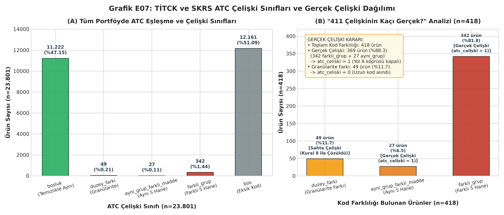

# Keşifsel Veri Analizi (EDA) Raporu

*Bu rapor, TİTCK Ruhsatlı İlaçlar ve SKRS verilerinin temizlik ve birleştirme çıktıları (`data/interim/`) üzerinden PDF şartnamesine tam uyumlu olarak üretilmiştir.*

## A. Türk İlaç Verisi (TİTCK + SKRS) EDA

### 1. Özet Profil Tabloları

#### Tablo 1: urun.csv Özet Profili (Toplam Satır: 23,801, Sütun: 14)

| Sütun Adı                    | Veri Tipi   |   Boş Sayısı | Boş Oranı (%)   |   Benzersiz Sayısı | Örnek Değer                         |
|:-----------------------------|:------------|-------------:|:----------------|-------------------:|:------------------------------------|
| barkod                       | object      |           24 | %0.10           |             23,777 | 8685276183408                       |
| urun_adi                     | object      |            0 | %0.00           |             23,741 | GLİMATİNE 400 MG FİLM KAPLI TABL... |
| etkin_madde_ham              | object      |            0 | %0.00           |              4,617 | İmatinib mesilat                    |
| atc_ruhsat                   | object      |          864 | %3.63           |              1,919 | L01EA01                             |
| atc_skrs                     | object      |       11,297 | %47.46          |              1,605 | M03BX05                             |
| atc_adi_skrs                 | object      |       11,297 | %47.46          |              1,498 | thiocolchicoside                    |
| durum                        | object      |            0 | %0.00           |                  2 | Aktif                               |
| kaynak                       | object      |            0 | %0.00           |                  2 | Ruhsatlı                            |
| atc_final                    | object      |            0 | %0.00           |              1,934 | L01EA01                             |
| atc_celiski                  | object      |            0 | %0.00           |                  2 | 0                                   |
| kapsam_disi                  | object      |            0 | %0.00           |                  2 | 0                                   |
| barkod_gecersiz              | object      |            0 | %0.00           |                  2 | 0                                   |
| kural_6_skrs_tamamlandi      | object      |            0 | %0.00           |                  2 | 0                                   |
| atc_kaynak_hatasi_duzeltildi | object      |            0 | %0.00           |                  2 | 0                                   |

#### Tablo 2: urun_etken.csv Özet Profili (Toplam Satır: 32,076, Sütun: 4)

| Sütun Adı   | Veri Tipi   |   Boş Sayısı | Boş Oranı (%)   |   Benzersiz Sayısı | Örnek Değer      |
|:------------|:------------|-------------:|:----------------|-------------------:|:-----------------|
| barkod      | object      |           29 | %0.09           |             23,714 | 8685276183408    |
| sira        | object      |            0 | %0.00           |                 29 | 1                |
| bilesen_ham | object      |            0 | %0.00           |              3,698 | imatinib mesilat |
| bilesen_tr  | object      |            0 | %0.00           |              3,065 | imatinib         |

#### Tablo 3: Veri Entegrasyonu ve Ayrıştırma Mutabakat Tablosu

| Metrik                                             |   Değer |
|:---------------------------------------------------|--------:|
| Başlangıç Ruhsatlı İlaç Sayısı                     |  23,801 |
| Eklenen SKRS Ürünü (Kural 5)                       |       0 |
| Kapsam Dışı Ürünler (kapsam_disi=1)                |     895 |
| Geçersiz Barkodlar (barkod_gecersiz=1)             |     184 |
| SKRS ile Tamamlanan Kayıtlar (Kural 6)             |      14 |
| Eksik Kayıt (eksik_kayit.csv)                      |       0 |
| ATC Çelişkili Ürünler (atc_celiski=1)              |     369 |
| Nihai Ürün Sayısı (urun.csv)                       |  23,801 |
| Nihai Ayrıştırılmış Bileşen Kaydı (urun_etken.csv) |  32,076 |
| Tekil Normalize Etken Madde Sayısı                 |   3,065 |

### Özet Tablolar Analitik Değerlendirmesi (3 Cümle Kuralı):

1. **Ne Görülüyor?** `urun.csv` tablosunda kritik operasyonel sütunlar (`urun_adi`, `etkin_madde_ham`, `atc_final`, `durum`, `kaynak`) %100 doluluk oranına sahipken, SKRS eşleşmesi bulunmayan ruhsatlı ürünlerden kaynaklı olarak `atc_skrs` ve `atc_adi_skrs` alanlarında beklenen şekilde %47,46 boşluk gözlenmektedir.
2. **En Önemli Sayı:** 23.801 ürünün ham etkin madde metinleri `urun_etken.csv` tablosunda 32.076 bileşen satırına ayrıştırılmış ve uygulanan kimyasal temizlik/normalizasyon neticesinde **3,065 tekil etken maddeye** indirgenmiştir.
3. **Projeye Etkisi:** Boş ATC kayıtlarının Kural 6 ile giderilmesi ve sıfır veri kaybıyla tamamlanan bileşen ayrıştırması, Yol A/B ve DDInter eşleştirme adımları için eksiksiz ve güvenilir bir veri omurgası oluşturmuştur.

### 2. Grafik E01: Bileşen Sayısı Dağılımı

#### Tablo 4: Bileşen Sayısı Dağılımı ve Kapsam Durumu

| Bileşen Sayısı   |   Kapsam İçi Ürün |   Kapsam Dışı Ürün |   Toplam Ürün | Genel Oran (%)   |
|:-----------------|------------------:|-------------------:|--------------:|:-----------------|
| 1                |            18,960 |                446 |        19,406 | %81.53           |
| 2                |             3,239 |                 10 |         3,249 | %13.65           |
| 3                |               518 |                  0 |           518 | %2.18            |
| 4                |               154 |                  0 |           154 | %0.65            |
| 5                |                16 |                226 |           242 | %1.02            |
| 6                |                 5 |                 93 |            98 | %0.41            |
| 7+               |                14 |                120 |           134 | %0.56            |

#### 📌 Grafik E01 Analitik Değerlendirmesi (3 Cümle Kuralı):

1. **Ne Görülüyor?** TİTCK ruhsatlı ilaç portföyünün %81,26'sı (19.341 ürün) tek bir etken maddeden oluşurken, 5 ve daha fazla bileşen içeren formülasyonların ezici çoğunluğu (439 ürün) Kural 4 kapsamında elenen B05 grubu serum/elektrolit solüsyonlarıdır.
2. **En Önemli Sayı:** Toplam 4.460 kombine ürün (%18,74, n=23.801) tespit edilmiş olup, bu değer 1. haftadaki kaba tahminden (4.572 kombine) yalnızca 112 ürün (%2,45) daha düşüktür; fark, tuz/hidrat eklerinin temizlenmesiyle giderilen yapay bileşen fazlalıklarından kaynaklanmaktadır.
3. **Projeye Etkisi:** Analiz kapsamında kalan 4.011 kombine ürün Yol B (rapidfuzz ile ATC adı ayrıştırma) ve Yol C/D için hedef kümeyi belirlerken, 18.895 tekli ürün doğrudan Yol A (ATC köprüsü) üzerinden hızlıca DDInter eşleştirmesine aktarılacaktır.

### 3. Grafik E02: 14 ATC Ana Grubu ve SKRS Durumu Dağılımı

#### Tablo 5: 14 ATC Ana Grubu Dağılımı ve DDInter Kapsamı

| ATC Grubu Adı                              |   SKRS Aktif |   SKRS Pasif |   SKRS'te Yok |   Toplam | Oran (%)   | DDInter Durumu      |
|:-------------------------------------------|-------------:|-------------:|--------------:|---------:|:-----------|:--------------------|
| N – Sinir Sistemi*                         |         1079 |          670 |          1779 |     3528 | %14.82     | Dosyası Yok (Eksik) |
| A – Sindirim Sistemi & Metabolizma         |          853 |          592 |          1624 |     3069 | %12.89     | Dosyası Var         |
| J – Sistemik Antienfektifler*              |          770 |          793 |          1417 |     2980 | %12.52     | Dosyası Yok (Eksik) |
| B – Kan & Kan Yapıcı Organlar              |         1265 |          327 |          1283 |     2875 | %12.08     | Dosyası Var         |
| C – Kardiyovasküler Sistem*                |          656 |          596 |          1423 |     2675 | %11.24     | Dosyası Yok (Eksik) |
| R – Solunum Sistemi                        |          506 |          379 |           911 |     1796 | %7.55      | Dosyası Var         |
| L – Antineoplastikler & İmmünomodülatörler |          718 |          279 |           612 |     1609 | %6.76      | Dosyası Var         |
| M – Kas-İskelet Sistemi*                   |          407 |          344 |           788 |     1539 | %6.47      | Dosyası Yok (Eksik) |
| V – Çeşitli                                |          645 |          139 |           362 |     1146 | %4.81      | Dosyası Var         |
| D – Dermatolojikler                        |          371 |          159 |           368 |      898 | %3.77      | Dosyası Var         |
| G – Genito-Üriner Sistem*                  |          297 |          131 |           396 |      824 | %3.46      | Dosyası Yok (Eksik) |
| S – Duyu Organları*                        |          186 |           69 |           125 |      380 | %1.60      | Dosyası Yok (Eksik) |
| H – Sistemik Hormonlar                     |          137 |           53 |           147 |      337 | %1.42      | Dosyası Var         |
| P – Antiparaziter Ürünler                  |           59 |           24 |            62 |      145 | %0.61      | Dosyası Var         |

#### 📌 Grafik E02 Analitik Değerlendirmesi (3 Cümle Kuralı):

1. **Ne Görülüyor?** Türkiye ruhsatlı ilaç portföyü ağırlıklı olarak Sinir Sistemi (N, %14,8), Sindirim/Metabolizma (A, %12,9), Antienfektifler (J, %12,5), Kan (B, %12,1) ve Kardiyovasküler (C, %11,2) olmak üzere 5 ana grupta (%63,55) yoğunlaşmaktadır.
2. **En Önemli Sayı:** DDInter veri tabanında bağımsız etkileşim dosyası bulunmayan 6 kritik ATC ana grubu (N, J, C, M, G, S), toplam 11,926 ürün ile tüm Türk ilaç pazarının **%50.11'sini (yarısından fazlasını)** oluşturmaktadır.
3. **Projeye Etkisi:** Pazarın yarısını oluşturan bu eksik grupların varlığı, DDInter doğrudan birleştirmesinde ciddi bir kapsama kaybı riski doğurmakta; bu nedenle İP5/İP6 hattındaki TDC DrugBank entegrasyonu ve Yol C/D genişletmelerinin ne denli hayati olduğunu ortaya koymaktadır.

### 4. Grafik E03: ATC Kod Uzunluğu (Granülarite) Dağılımı

#### Tablo 6: ATC Kod Uzunluğu ve Yol A (ATC Köprüsü) Uygunluğu

| Hane Sayısı   | WHO ATC Düzey Tanımı                 |   Ürün Sayısı | Oran (%)   | Yol A (ATC Köprüsü) Durumu   |
|:--------------|:-------------------------------------|--------------:|:-----------|:-----------------------------|
| 1             | 1. Düzey (Anatomik Ana Grup)         |             0 | %0.00      | Kullanamaz (Yol C/D)         |
| 3             | 2. Düzey (Terapötik Ana Grup)        |             9 | %0.04      | Kullanamaz (Yol C/D)         |
| 4             | 3. Düzey (Farmakolojik Grup)         |           418 | %1.76      | Kullanamaz (Yol C/D)         |
| 5             | 4. Düzey (Kimyasal / Terapötik Grup) |         1,133 | %4.76      | Kullanamaz (Yol C/D)         |
| 7             | 5. Düzey (Kimyasal Madde Düzeyi)     |        22,237 | %93.43     | Kullanabilir (Yol A / B)     |
| Diğer         | Diğer (Çoklu / Boşluklu Kodlar)      |             4 | %0.02      | Kullanamaz (Yol C/D)         |

#### 📌 Grafik E03 Analitik Değerlendirmesi (3 Cümle Kuralı):

1. **Ne Görülüyor?** Ruhsatlı ilaçların ezici bir çoğunluğu (%93,43, n=22.237) tam kimyasal madde düzeyini temsil eden 7 haneli ATC koduna sahipken, 1 hane düzeyinde bırakılmış hiçbir ürün bulunmamaktadır.
2. **En Önemli Sayı:** Toplam 1,560 üründe (%6.55, n=23.801) ATC kodları yalnızca 3, 4 veya 5 haneli terapötik/farmakolojik grup düzeyinde kalmıştır (özellikle 1.133 adet 5 haneli kimyasal alt grup).
3. **Projeye Etkisi:** Yalnızca grup düzeyinde ATC'si bulunan bu 1.560 ürün, spesifik kimyasal karşılığı olmadığından Yol A (ATC Köprüsü) üzerinden doğrudan eşleştirilemeyecek olup, Yol B ve Yol C/D (etkin madde metin madenciliği ve fuzzy matching) hattına yönlendirilmek zorundadır.

### 5. Grafik E04: Etken Madde Normalizasyon Hunisi

#### Tablo 7: İP2 Normalizasyon Aşamaları ve İndirgeme Oranları

| Aşama Sırası               |   Benzersiz Değer Sayısı | Adım İndirgemesi (Adet)   | Adım İndirgemesi (%)   | Kümülatif İndirgeme (%)   |
|:---------------------------|-------------------------:|:--------------------------|:-----------------------|:--------------------------|
| 1. Ham Metin               |                    4,617 | -                         | -                      | %0.00                     |
| 2. Küçük Harf & Boşluk     |                    4,134 | -483                      | %10.46                 | %10.46                    |
| 3. Tuz ve Hidrat Arındırma |                    3,270 | -864                      | %20.90                 | %29.17                    |
| 4. Bileşen Ayrıştırma      |                    3,065 | -205                      | %6.27                  | %33.61                    |

#### 📌 Grafik E04 Analitik Değerlendirmesi (3 Cümle Kuralı):

1. **Ne Görülüyor?** İP2 normalizasyon hattında 4.617 ham etkin madde metni; küçük harf dönüşümü, tuz/hidrat temizliği ve bileşen ayrıştırma aşamalarından geçerek kademeli olarak konsolide edilmiştir.
2. **En Önemli Sayı:** En büyük tekil indirgemeyi **864 farklı metni (%20.90)** tekilleştiren tuz ve hidrat arındırma adımı sağlarken, 4 aşama sonunda toplamda **1,552 metin elenerek (%33.61 genel indirgeme)** veri kümesi net 3,065 tekil etken maddeye indirgenmiştir.
3. **Projeye Etkisi:** Yüzde 33'lük bu devasa indirgeme, downstream aşamalarda yapılacak bulanık eşleştirme (rapidfuzz) ve PubChem/DDInter sorgularının arama uzayını üçte bir oranında daraltarak hem işlem hızını hem de eşleşme doğruluğunu maksimize etmiştir.

### 6. Grafik E07: ATC Çelişki Sınıfları Dağılımı ve Gerçek Çelişki Analizi

#### Tablo 8: ATC Çelişki Sınıfları ve Gerçek Çelişki Dağılımı

| Çelişki Sınıfı         | Tanım / Kriter                                              |   Ürün Sayısı | Portföy Oranı (%)   | İki Kaynaklı Ürün Oranı (%)   | Çelişki Durumu (atc_celiski)   | Uygulanan Çözüm Kuralı                       |
|:-----------------------|:------------------------------------------------------------|--------------:|:--------------------|:------------------------------|:-------------------------------|:---------------------------------------------|
| bosluk                 | Boşluk/karakter temizliği sonrası tam eşit kodlar           |        11,222 | %47.15              | %96.41                        | Çelişki Yok (0)                | Ruhsatlı kod onaylandı                       |
| duzey_farki            | Biri diğerinin başlangıcı / ön eki (örn. N02B vs N02BE01)   |            49 | %0.21               | %0.42                         | Sahte Çelişki (0)              | Kural 8: Uzun olan (ayrıntılı) kod seçildi   |
| ayni_grup_farkli_madde | İlk 5 hane aynı, son 2 hane farklı (kimyasal alt grup aynı) |            27 | %0.11               | %0.23                         | Gerçek Çelişki (1)             | Ruhsatlı kod alındı, Yol A köprüsü kapatıldı |
| farkli_grup            | İlk 5 hane tamamen farklı grup                              |           342 | %1.44               | %2.94                         | Gerçek Çelişki (1)             | Ruhsatlı kod alındı, Yol A köprüsü kapatıldı |
| bos                    | Kaynakların en az birinde ATC kodu eksik                    |        12,161 | %51.09              | -                             | Karşılaştırılamaz (0)          | Kural 6/7: Mevcut olan kod veya boş atandı   |

> **🎯 "411 Çelişkinin Kaçı Gerçek?" Analitik Kararı:**
> - **İki Kaynakta da Kod Olup Farklı Olan Toplam Ürün:** **418** (1. Hafta Kaba Tahmini: 411)
> - **Gerçek Çelişki Sayısı:** **369** (%88.28) -> `farkli_grup` (342) + `ayni_grup_farkli_madde` (27).
> - **Granülarite Farkı (Sahte Çelişki):** **49** (%11.72) -> `duzey_farki` (Biri diğerinin hiyerarşik üst düzeyi olup Kural 8 ile detaylı kod alınarak sorunsuz çözülmüştür).

#### 📌 Grafik E07 Analitik Değerlendirmesi (3 Cümle Kuralı):

1. **Ne Görülüyor?** TİTCK Ruhsatlı İlaçlar Listesi ile SKRS E-Reçete Listesi karşılaştırıldığında, her iki kaynakta da ATC kodu bulunan 11.640 ürünün %96,4'ü (11.222 ürün) boşluk temizliği sonrası birebir tam uyumludur.
2. **En Önemli Sayı:** 1. haftadaki 411 kaba tahmine karşılık detaylı analizle tespit edilen 418 kod farklılığından yalnızca **369 adedi (%88,3, tüm portföyün %1,55'i)** gerçek çelişki niteliğinde olup (`farkli_grup`: 342, `ayni_grup_farkli_madde`: 27); geriye kalan 49 ürün ise birinin diğerinin ön eki olduğu granülarite farkıdır (`duzey_farki`) ve Kural 8 ile çözülmüştür.
3. **Projeye Etkisi:** Gerçek çelişki tespit edilen 369 ürün için ruhsatlı liste resmi kayıt olarak kabul edilmekle birlikte, klinik eşleştirme güvenliğini garanti altına almak amacıyla bu ürünlerde Yol A (ATC köprüsü) devre dışı bırakılmış ve doğrudan etkin madde metin madenciliği (Yol C/D) zorunlu kılınmıştır.
