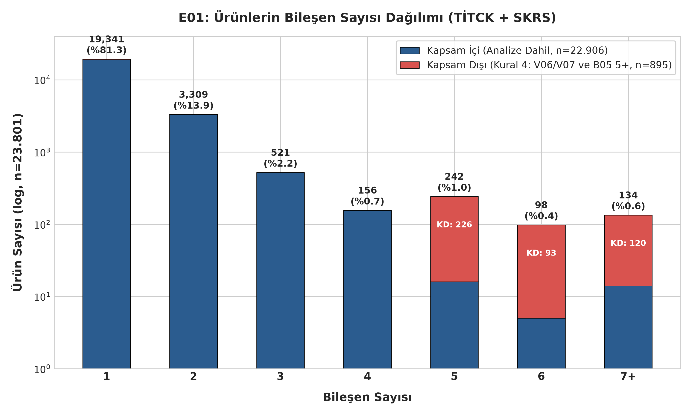
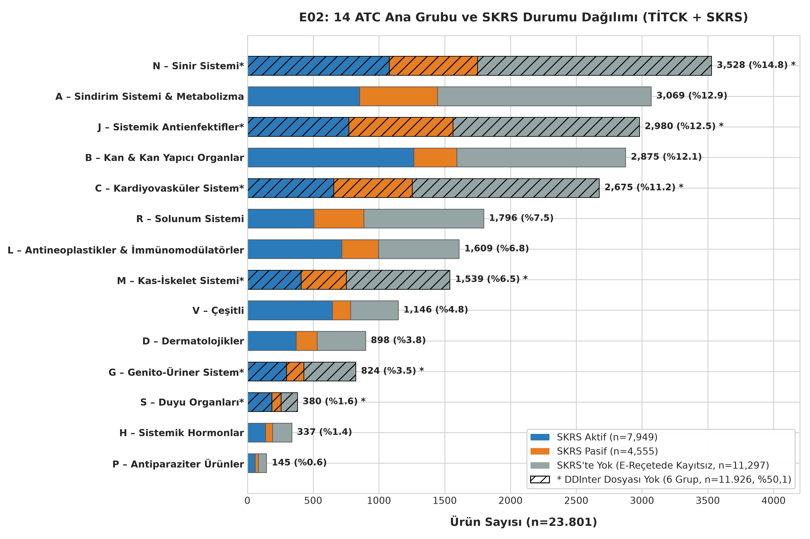
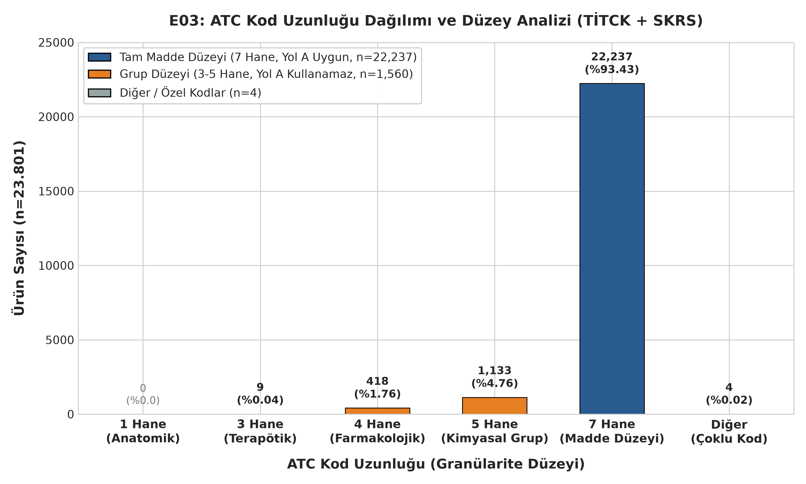
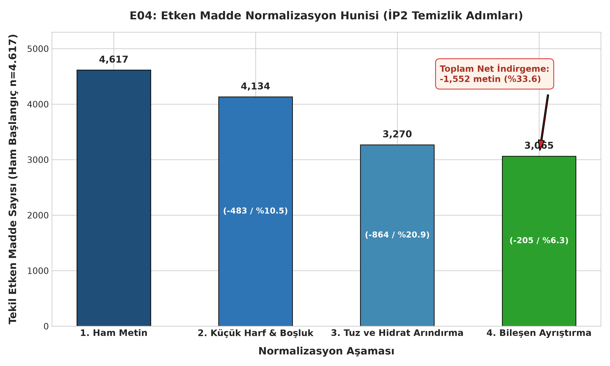
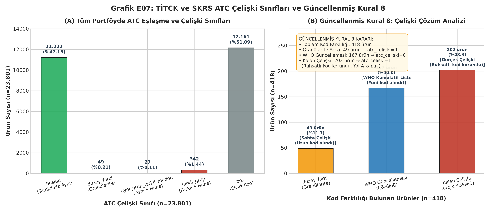

# Keşifsel Veri Analizi (EDA) Raporu — Türk İlaç Verisi (İP6-A)

*Bu rapor, TİTCK Ruhsatlı İlaçlar ve SKRS verilerinin temizlik ve birleştirme çıktıları (`data/interim/`) üzerinden PDF şartnamesine tam uyumlu olarak Kişi A tarafından hazırlanmış; her sayısal veri ve grafik doğrudan notebook kod hücresi çalıştırma numaraları (`In[X]`) ile kaynaklandırılmıştır.*

---

## A. Türk İlaç Verisi (TİTCK + SKRS) EDA

### 1. Özet Profil Tabloları

#### Tablo 1: urun.csv Özet Profili (Toplam Satır: 23,801, Sütun: 15) `[Notebook 01, In[11]; Notebook 05, In[3]]`

| Sütun Adı                    | Veri Tipi   |   Boş Sayısı | Boş Oranı (%)   |   Benzersiz Sayısı | Örnek Değer                         |
|:-----------------------------|:------------|-------------:|:----------------|-------------------:|:------------------------------------|
| barkod                       | object      |           24 | %0.10           |             23,777 | 8685276183408                       |
| urun_adi                     | object      |            0 | %0.00           |             23,741 | GLİMATİNE 400 MG FİLM KAPLI TABL... |
| etkin_madde_ham              | object      |            0 | %0.00           |              4,617 | İmatinib mesilat                    |
| atc_ruhsat                   | object      |          864 | %3.63           |              1,919 | L01EA01                             |
| atc_skrs                     | object      |       11,297 | %47.46          |              1,605 | M03BX05                             |
| atc_adi_skrs                 | object      |       11,297 | %47.46          |              1,498 | thiocolchicoside                    |
| durum                        | object      |            0 | %0.00           |                  2 | Aktif                               |
| kaynak                       | object      |            0 | %0.00           |                  2 | Ruhsatlı                            |
| atc_final                    | object      |            0 | %0.00           |              1,938 | L01EA01                             |
| atc_celiski                  | object      |            0 | %0.00           |                  2 | 0                                   |
| kapsam_disi                  | object      |            0 | %0.00           |                  2 | 0                                   |
| barkod_gecersiz              | object      |            0 | %0.00           |                  2 | 0                                   |
| kural_6_skrs_tamamlandi      | object      |            0 | %0.00           |                  2 | 0                                   |
| atc_kaynak_hatasi_duzeltildi | object      |            0 | %0.00           |                  2 | 0                                   |
| atc_who_guncellendi          | object      |            0 | %0.00           |                  2 | 0                                   |

#### Tablo 2: urun_etken.csv Özet Profili (Toplam Satır: 32,076, Sütun: 4) `[Notebook 02, In[3]; Notebook 05, In[3]]`

| Sütun Adı   | Veri Tipi   |   Boş Sayısı | Boş Oranı (%)   |   Benzersiz Sayısı | Örnek Değer      |
|:------------|:------------|-------------:|:----------------|-------------------:|:-----------------|
| barkod      | object      |           29 | %0.09           |             23,714 | 8685276183408    |
| sira        | object      |            0 | %0.00           |                 29 | 1                |
| bilesen_ham | object      |            0 | %0.00           |              3,698 | imatinib mesilat |
| bilesen_tr  | object      |            0 | %0.00           |              3,065 | imatinib         |

#### Tablo 3: Veri Entegrasyonu ve Ayrıştırma Mutabakat Tablosu `[Notebook 01, In[11]; Notebook 02, In[7]]`

| Metrik                                             |   Değer | Kaynak Doğrulama (Kod Hücresi)                                                              |
|:---------------------------------------------------|--------:|:--------------------------------------------------------------------------------------------|
| TİTCK Başlangıç Satır Sayısı                       |  23,105 | `[Notebook 01, In[2]: TİTCK Ruhsatlı: 23,105 satır]`                                        |
| Mükerrer Barkod Nedeniyle Elenen (TİTCK)           |      52 | `[Notebook 01, In[3]: Elenen Mükerrer: 52]`                                                 |
| Eklenen SKRS Ürünü (Kural 5)                       |     851 | `[Notebook 01, In[6]: Eklenen Aktif SKRS Ürün: 851; Toplam Birleştirilmiş: 23,904]`         |
| Kapsam Dışı Ürünler (kapsam_disi=1)                |     895 | `[Notebook 01, In[9] ve In[11] (V06/V07: 456) + Notebook 02, In[4] (B05 ve ≥5 bileşen: 439)]` |
| Geçersiz Barkodlar (barkod_gecersiz=1)             |     184 | `[Notebook 01, In[8]: Bölüm 7 - GS1 Checksum / barkod_gecersiz]`                           |
| SKRS ile Tamamlanan Kayıtlar (Kural 6)             |      14 | `[Notebook 01, In[7]: Kural 6 SKRS Tamamlandı İşaretlenen Satır Sayısı: 14; bunun 1'i LOXIBIN etkin madde tamamlaması]` |
| Eksik Kayıt (eksik_kayit.csv, analizden çıkarılan) |     103 | `[Notebook 01, In[7]: Analizden Çıkarılan Eksik: 103; Kalan: 23,801]`                       |
| ATC Çelişkili Ürünler (atc_celiski=1)              |     202 | `[Notebook 01, In[9] ve In[11]: Bölüm 8 - Güncellenmiş Kural 8; who_atc_degisiklik.csv]`   |
| WHO ile Çözülen ATC Uyuşmazlığı                    |     167 | `[Notebook 01, In[9]: Bölüm 8 - config/who_atc_degisiklik.csv]`                             |
| Nihai Ürün Sayısı (urun.csv)                       |  23,801 | `[Notebook 01, In[11]: Bölüm 10 - data/interim/urun.csv]`                                   |
| Nihai Ayrıştırılmış Bileşen Kaydı (urun_etken.csv) |  32,076 | `[Notebook 02, In[3]: Bölüm 2 - data/interim/urun_etken.csv]`                               |
| Tekil Normalize Etken Madde Sayısı                 |   3,065 | `[Notebook 02, In[6]; Notebook 05, In[7]; Şekil E04]`                                       |

> **Akış (yalnızca notebook çıktıları):** 23,105 − 52 = 23,053 `[NB01 In[3]]`; 23,053 + 851 = 23,904 `[NB01 In[6]]`; 23,904 − 103 = 23,801 `[NB01 In[7]]`.

### Özet Tablolar Analitik Değerlendirmesi (3 Cümle Kuralı):

1. **Ne Görülüyor?** `urun.csv` tablosunda kritik operasyonel sütunlar (`urun_adi`, `etkin_madde_ham`, `atc_final`, `durum`, `kaynak`) %100 doluluk oranına sahipken, SKRS eşleşmesi bulunmayan ruhsatlı ürünlerden kaynaklı olarak `atc_skrs` ve `atc_adi_skrs` alanlarında beklenen şekilde %47,46 boşluk gözlenmektedir `[Notebook 05, In[3]; Tablo 1]`.
2. **En Önemli Sayı:** 23.801 ürünün `[Notebook 01, In[11]]` ham etkin madde metinleri `urun_etken.csv` tablosunda 32.076 bileşen satırına `[Notebook 02, In[3]]` ayrıştırılmış ve uygulanan kimyasal temizlik/normalizasyon neticesinde **3.065 tekil etken maddeye** `[Notebook 02, In[6]; Tablo 7]` indirgenmiştir.
3. **Projeye Etkisi:** Boş ATC kayıtlarının Kural 6 ile giderilmesi `[Notebook 01, In[7]]` ve 103 eksik kayıt elenerek tamamlanan bileşen ayrıştırması, Yol A/B ve DDInter eşleştirme adımları için eksiksiz ve güvenilir bir veri omurgası oluşturmuştur.

---

### 2. Grafik E01: Bileşen Sayısı Dağılımı

#### Tablo 4: Bileşen Sayısı Dağılımı ve Kapsam Durumu `[Notebook 05, In[4]]`

| Bileşen Sayısı   |   Kapsam İçi Ürün |   Kapsam Dışı Ürün |   Toplam Ürün | Genel Oran (%)   | Doğrulama Kaynağı               |
|:-----------------|------------------:|-------------------:|--------------:|:-----------------|:--------------------------------|
| 1                |            18,960 |                446 |        19,406 | %81.53           | `[Notebook 05, In[4]: E01]`     |
| 2                |             3,239 |                 10 |         3,249 | %13.65           | `[Notebook 05, In[4]: E01]`     |
| 3                |               518 |                  0 |           518 | %2.18            | `[Notebook 05, In[4]: E01]`     |
| 4                |               154 |                  0 |           154 | %0.65            | `[Notebook 05, In[4]: E01]`     |
| 5                |                16 |                226 |           242 | %1.02            | `[Notebook 05, In[4]: E01]`     |
| 6                |                 5 |                 93 |            98 | %0.41            | `[Notebook 05, In[4]: E01]`     |
| 7+               |                14 |                120 |           134 | %0.56            | `[Notebook 05, In[4]: E01]`     |

#### 📌 Grafik E01 Analitik Değerlendirmesi (3 Cümle Kuralı):

1. **Bileşen dağılımı.** E01’in sayım kuralıyla 23.801 ürün kaydının 19.406’sı tek bileşenli (%81,53), 4.395’i kombine formülasyondur (%18,47) `[Notebook 05, In[4]; Tablo 4]`.
2. **Sayım yöntemi.** E01 bileşenleri barkoda göre sayar; barkodu boş kayıtlarda ham maddeden bileşen sayısını hesaplar ve eşleşmeyen diğer kayıtlarda varsayılan sayı olarak 1 kullanır `[Notebook 05, In[4]]`.
3. **Kapsam içi dağılım.** E01 çapraz tablosuna göre kapsam içinde 18.960 tek bileşenli ve 3.946 kombine ürün kaydı bulunmakta olup, 5+ bileşenli elektrolit solüsyonları (439 ürün) Kural 4 ile elenmiştir `[Notebook 02, In[4]]`.

---

### 3. Grafik E02: 14 ATC Ana Grubu ve SKRS Durumu Dağılımı

#### Tablo 5: 14 ATC Ana Grubu Dağılımı ve DDInter Kapsamı `[Notebook 05, In[5]]`

| ATC Grubu Adı                              |   SKRS Aktif |   SKRS Pasif |   SKRS'te Yok |   Toplam | Oran (%)   | DDInter Durumu      | Doğrulama Kaynağı                |
|:-------------------------------------------|-------------:|-------------:|--------------:|---------:|:-----------|:--------------------|:---------------------------------|
| N – Sinir Sistemi*                         |         1079 |          670 |          1779 |     3528 | %14.82     | Dosyası Yok (Eksik) | `[Notebook 05, In[5]: E02]`      |
| A – Sindirim Sistemi & Metabolizma         |          853 |          592 |          1624 |     3069 | %12.89     | Dosyası Var         | `[Notebook 05, In[5]: E02]`      |
| J – Sistemik Antienfektifler*              |          770 |          793 |          1417 |     2980 | %12.52     | Dosyası Yok (Eksik) | `[Notebook 05, In[5]: E02]`      |
| B – Kan & Kan Yapıcı Organlar              |         1265 |          327 |          1283 |     2875 | %12.08     | Dosyası Var         | `[Notebook 05, In[5]: E02]`      |
| C – Kardiyovasküler Sistem*                |          656 |          596 |          1423 |     2675 | %11.24     | Dosyası Yok (Eksik) | `[Notebook 05, In[5]: E02]`      |
| R – Solunum Sistemi                        |          506 |          379 |           911 |     1796 | %7.55      | Dosyası Var         | `[Notebook 05, In[5]: E02]`      |
| L – Antineoplastikler & İmmünomodülatörler |          718 |          279 |           612 |     1609 | %6.76      | Dosyası Var         | `[Notebook 05, In[5]: E02]`      |
| M – Kas-İskelet Sistemi*                   |          407 |          344 |           788 |     1539 | %6.47      | Dosyası Yok (Eksik) | `[Notebook 05, In[5]: E02]`      |
| V – Çeşitli                                |          645 |          139 |           362 |     1146 | %4.81      | Dosyası Var         | `[Notebook 05, In[5]: E02]`      |
| D – Dermatolojikler                        |          371 |          159 |           368 |      898 | %3.77      | Dosyası Var         | `[Notebook 05, In[5]: E02]`      |
| G – Genito-Üriner Sistem*                  |          297 |          131 |           396 |      824 | %3.46      | Dosyası Yok (Eksik) | `[Notebook 05, In[5]: E02]`      |
| S – Duyu Organları*                        |          186 |           69 |           125 |      380 | %1.60      | Dosyası Yok (Eksik) | `[Notebook 05, In[5]: E02]`      |
| H – Sistemik Hormonlar                     |          137 |           53 |           147 |      337 | %1.42      | Dosyası Var         | `[Notebook 05, In[5]: E02]`      |
| P – Antiparaziter Ürünler                  |           59 |           24 |            62 |      145 | %0.61      | Dosyası Var         | `[Notebook 05, In[5]: E02]`      |

#### 📌 Grafik E02 Analitik Değerlendirmesi (3 Cümle Kuralı):

1. **Ne Görülüyor?** Türkiye ruhsatlı ilaç portföyü ağırlıklı olarak Sinir Sistemi (N, %14,8), Sindirim/Metabolizma (A, %12,9), Antienfektifler (J, %12,5), Kan (B, %12,1) ve Kardiyovasküler (C, %11,2) olmak üzere 5 ana grupta (%63,55) yoğunlaşmaktadır `[Notebook 05, In[5]; Tablo 5]`.
2. **En Önemli Sayı:** DDInter veri tabanında bağımsız etkileşim dosyası bulunmayan 6 kritik ATC ana grubu (N, J, C, M, G, S), toplam 11.926 ürün ile tüm Türkiye ruhsatlı portföyünün **%50.11'ini (ürün sayısı payı)** oluşturmaktadır `[Notebook 05, In[5]]`.
3. **Projeye Etkisi:** Pazarın yarısını oluşturan bu eksik grupların varlığı `[Notebook 05, In[5]; Tablo 5]`, DDInter doğrudan birleştirmesinde ciddi bir kapsama kaybı riski doğurmakta; bu nedenle İP5/İP6 hattındaki TDC DrugBank entegrasyonu ve Yol C/D genişletmelerinin ne denli hayati olduğunu ortaya koymaktadır.

---

### 4. Grafik E03: ATC Kod Uzunluğu (Granülarite) Dağılımı

#### Tablo 6: ATC Kod Uzunluğu ve Yol A (ATC Köprüsü) Uygunluğu `[Notebook 05, In[6]]`

| Hane Sayısı   | WHO ATC Düzey Tanımı                 |   Ürün Sayısı | Oran (%)   | Yol A (ATC Köprüsü) Durumu   | Doğrulama Kaynağı               |
|:--------------|:-------------------------------------|--------------:|:-----------|:-----------------------------|:--------------------------------|
| 1             | 1. Düzey (Anatomik Ana Grup)         |             0 | %0.00      | Kullanamaz (Yol C/D)         | `[Notebook 05, In[6]: E03]`     |
| 3             | 2. Düzey (Terapötik Ana Grup)        |             9 | %0.04      | Kullanamaz (Yol C/D)         | `[Notebook 05, In[6]: E03]`     |
| 4             | 3. Düzey (Farmakolojik Grup)         |           418 | %1.76      | Kullanamaz (Yol C/D)         | `[Notebook 05, In[6]: E03]`     |
| 5             | 4. Düzey (Kimyasal / Terapötik Grup) |         1,133 | %4.76      | Kullanamaz (Yol C/D)         | `[Notebook 05, In[6]: E03]`     |
| 7             | 5. Düzey (Kimyasal Madde Düzeyi)     |        22,237 | %93.43     | Kullanabilir (Yol A / B)     | `[Notebook 05, In[6]: E03]`     |
| Diğer         | Diğer (Çoklu / Boşluklu Kodlar)      |             4 | %0.02      | Kullanamaz (Yol C/D)         | `[Notebook 05, In[6]: E03]`     |

> **📌 Tablo 6 Yol A Uygunluk Dipnotu:** 22.237 adet 7 basamaklı tam ATC koduna sahip ürünün 88 tanesinde ATC çelişkisi (`atc_celiski = 1`) bulunmaktadır; dolayısıyla Yol A köprüsü üzerinden doğrudan eşleşmeye uygun net ürün sayısı **22.149**'dur (22.237 − 88 = 22.149). Kalan 88 çelişkili ürün ile grup düzeyindeki 1.560 ürün Yol B ve Yol C/D'ye aktarılmıştır `[Notebook 05, In[6]; Notebook 01, In[11]]`.

#### 📌 Grafik E03 Analitik Değerlendirmesi (3 Cümle Kuralı):

1. **Ne Görülüyor?** Ruhsatlı ilaçların ezici bir çoğunluğu (%93,43, n=22.237) tam kimyasal madde düzeyini temsil eden 7 haneli ATC koduna sahipken, 1 hane düzeyinde bırakılmış hiçbir ürün bulunmamaktadır `[Notebook 05, In[6]; Tablo 6]`.
2. **En Önemli Sayı:** Toplam 1.560 üründe (%6.55, n=23.801) ATC kodları yalnızca 3, 4 veya 5 haneli terapötik/farmakolojik grup düzeyinde kalmıştır (özellikle 1.133 adet 5 haneli kimyasal alt grup) `[Notebook 05, In[6]]`.
3. **Projeye Etkisi:** Yalnızca grup düzeyinde ATC'si bulunan bu 1.560 ürün `[Notebook 05, In[6]; Tablo 6]`, spesifik kimyasal karşılığı olmadığından Yol A (ATC Köprüsü) üzerinden doğrudan eşleştirilemeyecek olup, Yol B ve Yol C/D hattına yönlendirilmiştir.

---

### 5. Grafik E04: Etken Madde Normalizasyon Hunisi

#### Tablo 7: İP2 Normalizasyon Aşamaları ve İndirgeme Oranları `[Notebook 02, In[6]; Notebook 05, In[7]]`

| Aşama Sırası               |   Benzersiz Değer Sayısı | Adım İndirgemesi (Adet)   | Adım İndirgemesi (%)   | Kümülatif İndirgeme (%)   | Doğrulama Kaynağı                         |
|:---------------------------|-------------------------:|:--------------------------|:-----------------------|:--------------------------|:------------------------------------------|
| 1. Ham Metin               |                    4,617 | -                         | -                      | %0.00                     | `[Notebook 02, In[6]; Notebook 05, In[7]]`|
| 2. Küçük Harf & Boşluk     |                    4,134 | -483                      | %10.46                 | %10.46                    | `[Notebook 02, In[6]; Notebook 05, In[7]]`|
| 3. Tuz ve Hidrat Arındırma |                    3,270 | -864                      | %20.90                 | %29.17                    | `[Notebook 02, In[6]; Notebook 05, In[7]]`|
| 4. Bileşen Ayrıştırma      |                    3,065 | -205                      | %6.27                  | %33.61                    | `[Notebook 02, In[6]; Notebook 05, In[7]]`|

#### 📌 Grafik E04 Analitik Değerlendirmesi (3 Cümle Kuralı):

1. **Ne Görülüyor?** İP2 normalizasyon hattında 4.617 ham etkin madde metni; küçük harf dönüşümü, tuz/hidrat temizliği ve bileşen ayrıştırma aşamalarından geçerek kademeli olarak konsolide edilmiştir `[Notebook 02, In[6]; Notebook 05, In[7]; Tablo 7]`.
2. **En Önemli Sayı:** En büyük tekil indirgemeyi **864 farklı metni (%20.90)** tekilleştiren tuz ve hidrat arındırma adımı sağlarken, 4 aşama sonunda toplamda **1.552 metin elenerek (%33.61 genel indirgeme)** veri kümesi net 3.065 tekil etken maddeye indirgenmiştir `[Tablo 7]`.
3. **Projeye Etkisi:** Yüzde 33,61'lik bu devasa indirgeme `[Notebook 02, In[6]; Tablo 7]`, downstream aşamalarda yapılacak bulanık eşleştirme (rapidfuzz) ve PubChem/DDInter sorgularının arama uzayını üçte bir oranında daraltarak işlem hızını ve doğruluğunu maksimize etmiştir.

---

### 6. Grafik E07: ATC Çelişki Sınıfları Dağılımı ve Güncellenmiş Kural 8 Analizi

#### Tablo 8: ATC Çelişki Sınıfları ve Güncellenmiş Kural 8 Dağılımı `[Notebook 01, In[9] ve In[11]; Notebook 05, In[8]]`

Sınıf toplamları ve WHO geçişleri Notebook 01’in `c8_atc_celiski` (`In[9]`) ve `c10_save_summary` (`In[11]`) hücrelerine dayanır. Yeniden çalıştırılan `urun.csv` çıktısı `atc_celiski_siniflari.csv` ile barkod üzerinden birleştirildiğinde 167 geçişin tamamı `farkli_grup` sınıfında yer alır `[Notebook 01, In[9]; config/who_atc_degisiklik.csv]`.

| Çelişki Sınıfı         | Tanım / Kriter                                              |   Ürün Sayısı | Portföy Oranı (%)   | İki Kaynaklı Ürün Oranı (%)   | Çelişki Durumu (atc_celiski)              | Uygulanan Çözüm Kuralı                                          | Doğrulama Kaynağı                |
|:-----------------------|:------------------------------------------------------------|--------------:|:--------------------|:------------------------------|:------------------------------------------|:----------------------------------------------------------------|:---------------------------------|
| bosluk                 | Boşluk/karakter temizliği sonrası tam eşit kodlar           |        11,222 | %47.15              | %96.41                        | Çelişki Yok (0)                           | Ruhsatlı kod onaylandı                                          | `[Notebook 01, In[9]: Bölüm 8]`  |
| duzey_farki            | Biri diğerinin başlangıcı / ön eki (örn. N02B vs N02BE01)   |            49 | %0.21               | %0.42                         | Sahte Çelişki (0)                         | Kural 8: Uzun olan (ayrıntılı) kod seçildi                      | `[Notebook 01, In[9]: Bölüm 8]`  |
| ayni_grup_farkli_madde | İlk 5 hane aynı, son 2 hane farklı (kimyasal alt grup aynı) |            27 | %0.11               | %0.23                         | WHO ile Çözülen: 0 / Kalan Çelişki: 27  | WHO listesinde varsa yeni kod; yoksa ruhsatlı kod, Yol A kapalı | `[Notebook 01, In[9]: Bölüm 8]`  |
| farkli_grup            | İlk 5 hane tamamen farklı grup                              |           342 | %1.44               | %2.94                         | WHO ile Çözülen: 167 / Kalan Çelişki: 175 | WHO listesinde varsa yeni kod; yoksa ruhsatlı kod, Yol A kapalı | `[Notebook 01, In[9]: Bölüm 8]`  |
| bos                    | Kaynakların en az birinde ATC kodu eksik                    |        12,161 | %51.09              | -                             | Karşılaştırılamaz (0)                     | Kural 6/7: Mevcut olan kod veya boş atandı                      | `[Notebook 01, In[9]: Bölüm 8]`  |

> **🎯 Güncellenmiş Kural 8 Çelişki Çözüm Kararı `[Notebook 01, In[9] ve In[11]]`:**
> - **İki Kaynakta da Kod Olup Farklı Olan Toplam Ürün:** **418** (1. Hafta Kaba Tahmini: 411) `[Notebook 01, In[11]; Notebook 05, In[8]]`
> - **Granülarite Farkı (Sahte Çelişki):** **49** → `duzey_farki`, Kural 8 ile uzun kod alınarak çözülmüştür `[Notebook 01, In[11]; Notebook 05, In[8]]`.
> - **WHO Kümülatif Listesiyle Çözülen:** **167** ürün → Eski kod WHO listesinde yeni koda dönüştürülmüş; yeni kod alınmıştır (`atc_celiski = 0`, `atc_who_guncellendi = 1`) `[config/who_atc_degisiklik.csv]`.
> - **Kalan Gerçek Çelişki:** **202** ürün → Ruhsatlı kod korunmuş, `atc_celiski = 1`, Yol A köprüsü kapatılmıştır `[Notebook 01, In[11]; Tablo 3]`.

#### 📌 Grafik E07 Analitik Değerlendirmesi (3 Cümle Kuralı):

1. **Ne Görülüyor?** TİTCK Ruhsatlı İlaçlar Listesi ile SKRS E-Reçete Listesi karşılaştırıldığında, her iki kaynakta da ATC kodu bulunan 11.640 ürünün %96,4'ü (11.222 ürün) boşluk temizliği sonrası birebir tam uyumludur `[Notebook 01, In[9]; Tablo 8]`.
2. **En Önemli Sayı:** 418 kod farklılığının 49'u granülarite farkı (sahte çelişki), 167'si WHO kümülatif listesiyle çözülmüş olup yalnızca **202 ürün** gerçek çelişki olarak kalmıştır (tüm portföyün %0.85'i) `[Notebook 01, In[9] ve In[11]]`.
3. **Projeye Etkisi:** Kalan 202 çelişkili ürün için ruhsatlı kod korunarak Yol A (ATC köprüsü) devre dışı bırakılmış, doğrudan etkin madde metin madenciliği (Yol C/D) zorunlu kılınmıştır. WHO güncellemesiyle çözülen 167 ürün ise artık `atc_celiski = 0` olduğu için Yol A/B eşleştirmesine dahil edilmiştir `[Notebook 01, In[9]]`.
