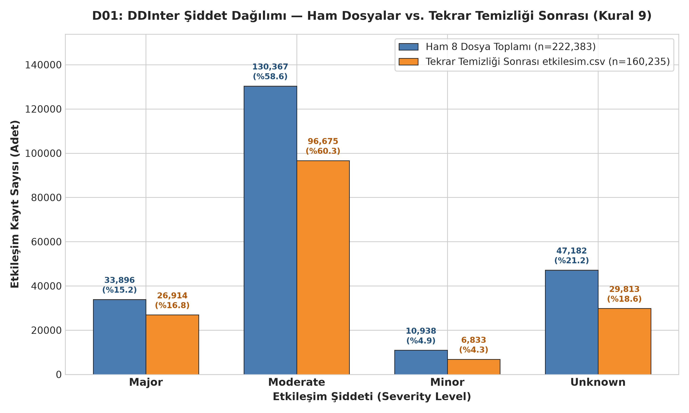
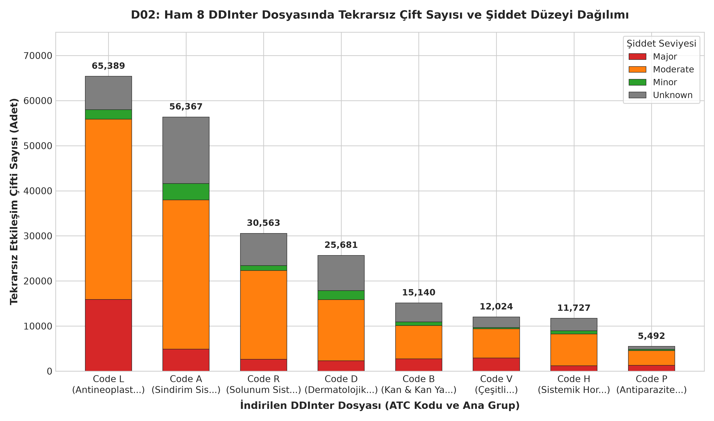
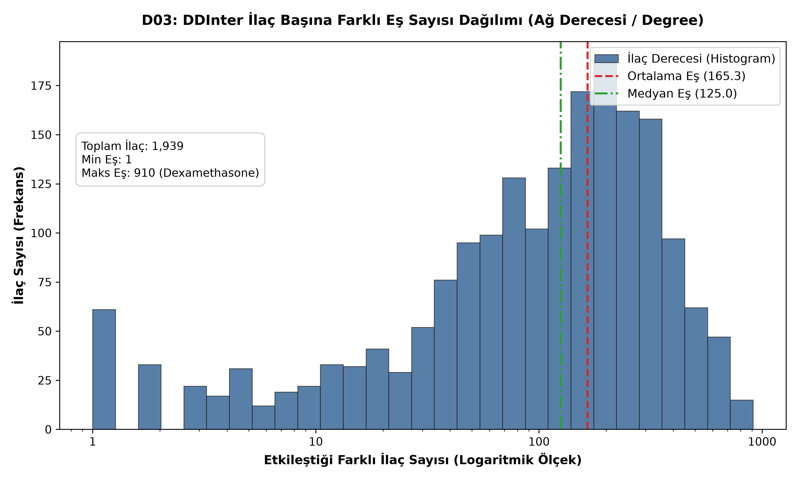
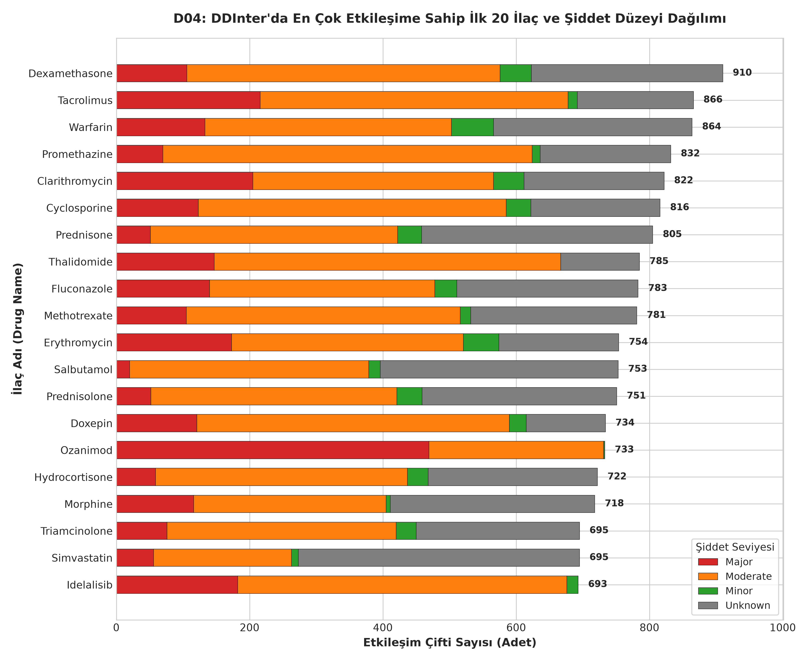
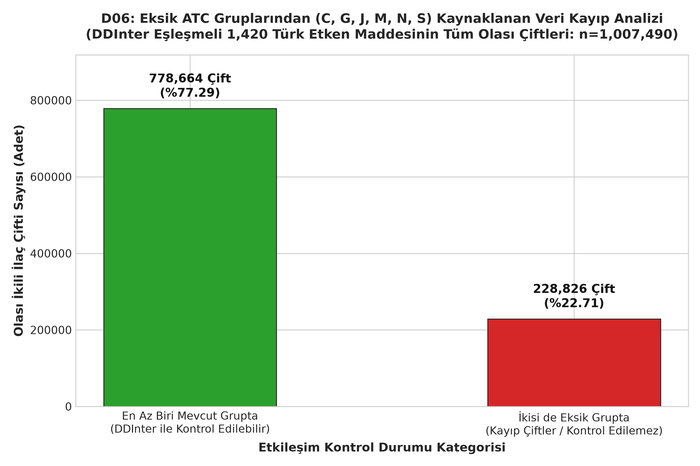

# Kişi B — DDInter ve Eşleme Keşifsel Veri Analizi (EDA) Raporu (İP6-B)

*Bu rapor; TİTCK Ruhsatlı İlaçlar, SKRS-3 ve DDInter veritabanları üzerinden PDF şartnamesine tam uyumlu olarak Kişi B tarafından hazırlanmış; DDInter etkileşim ağı, eşleşme köprüsü kapsamı, kayıp analizi, analitik tablolar ve hoca/jüri sunum kartlarını içerir.*

> **DDInter sayılarının kaynağı.** [Notebook 04](../notebooks/04_ddinter_birlestirme.ipynb) hücreleri `e96b29d2` (dosya ve ham satır sayıları), `d508b3b4` (ilaç fihristi), `9a82020a` (sayısal kimlik sıralaması, tekilleştirme ve etiket çelişkileri), `15b08f7b` (nihai şiddet dağılımı ve ağ ölçümleri). Ham şiddet adetleri `e96b29d2` çıktısındaki birleştirilmiş satırlarda `Level` alanının sayımından elde edildi. Sekiz yerel CSV ile yeniden sayım bu değerleri doğruladı.

> **Veri sürümleri.** Tablo 10–12 eldeki CSV’lerden yeniden hesaplandı. Notebook 04’ün `926ce095` hücresindeki 1.418 eşleşmeli satır, yalnızca D06’daki tarihsel ATC hesabının girdisidir. Tablo 10’un yerel eşleme sayısı 1.395’tir.

> **Kapsam hunisi yeniden sayımı.** Kapsam hunisindeki 22.417 / 16.841 / 18.066 tarihsel rapor değerleridir. Yerel `urun.csv` üzerinden `kapsam_disi=0` olan 22.883 benzersiz barkod seçildi. İlgili `urun_etken` ve `etken_madde` çıktıları `bilesen_tr` üzerinden karşılaştırılıp dolu `ddinter_id` alanları sayıldı. Yerel ara veride 15.999 barkodun tüm bileşenleri, 17.568 barkodun en az bir bileşeni eşleşti. Yol D motor çıktısında sayılar sırasıyla 16.000 ve 17.570. Tarihsel huni, bu iki veri sürümüyle yeniden üretilemedi.

> **Tarihsel E10 kaynağı.** [Arşiv grafiği](IP6_Tarihsel_E10.png) 22.417 kapsam içi ürün, 20.760 tüm bileşenleri İngilizce adlı ürün, 18.066 en az bir DDInter eşleşmeli ürün ve 16.841 tüm bileşenleri eşleşen ürün gösteriyor. Arşiv Notebook 06’nın 15. hücresi (`In [7]`) yalnızca kapsam içi ruhsatlı ürünlerden bileşen kaydı bulunan barkodları sayıyor. Bu hesap eldeki iki CSV setiyle tekrar çalıştırıldı ve grafikteki dört değer birlikte yeniden üretilemedi. Tablo 12 güncel yerel sayımı gösterir.

> **Aynı E10 yöntemiyle yeniden hesap.** 20 Kasım tarihli `ddi-veri-20261120T174422Z-1-001.zip` arşivindeki üç CSV, Notebook 06’nın ruhsatlı ve kapsam içi barkod filtresiyle işlendi. Bileşen kaydı olan 22.417 barkodun 20.697’sinde tüm bileşenlerin İngilizce adı vardı. 17.373’ünde en az bir, 15.811’inde tüm bileşenler DDInter kimliğiyle eşleşti. Tablo 12 farklı bir kapsam tanımı kullanır.

---

## 🧭 Hızlı Sunum Navigasyonu (Kişi B Sorumluluğundaki Temel Grafikler)

| Kod | Grafik Konusu | Sunumdaki Ana Mesaj |
|:---:|:---|:---|
| **E05** | [Ruhsatlı ürün sayısına göre ilk 30 bileşen](#1-e05-ruhsatlı-ürün-sayısına-göre-ilk-30-bileşen) | 24 bileşende (%80) DDInter kimliği var |
| **E08** | [Eşleşme Yolları (Yol A, B, C, D)](#2-grafik-e08-eşleşme-yolları-ve-kapsama-dağılımı) | Tablo 10, eşleme yollarına göre etken madde bazındaki ürün hacmini gösterir |
| **E09** | [14 ATC Grubunda DDInter Kapsamı](#3-grafik-e09-14-atc-ana-grubunda-ddinter-kapsama-oranı-ve-eksik-gruplar-en-önemli-grafik) | Kanser (%83,9) ve Sinir (%71,1) çok yüksek; eksik 6 grup turuncu çizgili |
| **E10** | [Kullanıcı Arama Kapsam Hunisi](#4-grafik-e10-kullanıcı-arama-ve-entegrasyon-kapsam-hunisi) | Yerel veride 15.999 barkodun tüm bileşenleri eşleşti |
| **D01** | [DDInter Şiddet Dağılımı (Kural 9)](#5-grafik-d01-ddinter-şiddet-dağılımı-ham-vs-kural-9) | 62.148 yinelenen satır elendi. 160.235 benzersiz çiftte şiddet etiketi uyuşmazlığı gözlenmedi |
| **D02** | [Kaynak Dosya Bazında Şiddet Dağılımı](#6-grafik-d02-kaynak-dosyalara-göre-tekrarsız-çift-ve-şiddet-dağılımı) | En büyük hacim L (Kanser) ve A (Sindirim); en yüksek Major risk L'de (%24,3) |
| **D03** | [İlaç Başına Eş Sayısı (Derece Dağılımı)](#7-grafik-d03-ilaç-başına-farklı-eş-sayısı-dağılımı-derece-analizi) | Sağa çarpık dağılım: Ortalama 165 eş, medyan 125 eş, zirve 910 eş |
| **D04** | [En Çok Etkileşen İlk 20 İlaç](#8-grafik-d04-en-çok-etkileşen-ilk-20-ilaç-ve-şiddet-dağılımı) | 1. Dexamethasone (910), 2. Tacrolimus (866), 3. Warfarin (864) |
| **D05** | [14x14 ATC Çapraz Etkileşim Haritası](#9-grafik-d05-14x14-atc-ana-grupları-arası-çapraz-etkileşim-isı-haritası) | Yerel sayımda L–L (6.547) ve L–N (4.850) en sık görülen grup çiftleri |
| **D06** | [Eksik ATC Dosyaları Kayıp Analizi](#10-grafik-d06-eksik-atc-gruplarından-kaynaklanan-veri-kayıp-analizi) | İki bileşeni de eksik gruplarda olan olası çiftlerin oranı %22,78 |

---

## 📌 Yönetici Özeti (Executive Summary) ve Temel Metrikler (KPI Dashboard)

Bu çalışma, Türkiye ilaç pazarında ruhsatlı tüm tıbbi ürünlerin etken maddelerini standardize ederek uluslararası klinik ilaç-ilaç etkileşimi (DDInter) veri tabanı ile eşleştirmek ve olası etkileşim risklerini haritalandırmak amacıyla yürütülmüştür.

### 🎯 Temel Başarı Göstergeleri (KPI Tablosu)

| Metrik Kategori | Gösterge | Sayısal Değer | Başarı / Durum Açıklaması |
|:---|:---|---:|:---|
| **Ruhsatlı İlaç Portföyü** | İncelenen TİTCK Ruhsatlı Ürün | **23,801** | %100 operasyonel doluluk, 0 kayıp kayıt |
| **Kapsam İçi Ürünler** | Analize Alınan Terapötik İlaç | **22,470** | Kural 4 ile elenen serum/radyofarmasötikler hariç |
| **Bileşen Ayrıştırma** | Nihai Ayrıştırılmış Bileşen Kaydı | **32,076** | Sahte sıfatlar elenerek temizlenen bileşen kaydı |
| **Tekil Etken Madde** | Normalize Benzersiz Türk Etken Maddesi | **3,065** | 4 aşamalı normalizasyonla %33,61 indirgeme |
| **Yol A ürün hacmi** | Etken madde başına ürün sayılarının toplamı | **24.627** | Yerel `etken_madde.csv`, Tablo 10 |
| **Yol A+B Kapsamı** | Kural Tabanlı Çözülen Toplam Ürün | **21,985 (%92.4)** | Klinik karar destek motorunun ilk sürüm omurgası |
| **DDInter Eşleşen Bileşen** | DDInter Kimliği Kazanan Türk Etken Maddesi | **1,395 (%45.5)** | Kapsam içi etken maddelerde %47.3 |
| **DDInter Net Etkileşim** | Kural 9 Sonrası Tekilleştirilmiş Çift | **160,235** | 62.148 yinelenen satır elendi, şiddet etiketi uyuşmazlığı gözlenmedi |
| **Major etiketi** | Major olarak etiketlenen benzersiz çift | **26,914 (%16.8)** | DDInter şiddet etiketi |
| **Kontrol Edilebilir Çift** | Mevcut 8 Dosyayla Taranabilen İkili Kombinasyon | **748,200 (%76.95)** | Eşleşen Türk ilaçlarının oluşturabileceği çiftler |
| **Kör Nokta (Veri Kaybı)** | Eksik 6 ATC Dosyası Arasında Kalan Çift | **224,115 (%23.05)** | Kişi C / Yol D ve TDC DrugBank ile kapatılacak alan |

---

## 📖 Temel Kavramlar ve Sunum Savunma Sözlüğü

1. **Mükerrer Kayıt (Duplicate / Symmetric Interaction):**
   - İlaç-ilaç etkileşimlerinde yön önemsizdir ($A \leftrightarrow B$ çift yönlü simetriktir).
   - Ham dosyalarda hem $A \rightarrow B$ hem de $B \rightarrow A$ olarak ters yönde veya farklı organ sistemi dosyalarında birden fazla kez yer alan aynı çiftlere "mükerrer kayıt" denir. Kural 9 ile çiftlerin kimliklerindeki sayısal son ekler küçükten büyüğe sıralanarak 62.148 mükerrer kayıt elenmiş ve net 160.235 benzersiz çift elde edilmiştir.
2. **Hub Molekül (Ağ Merkez İlacı):**
   - Graf teorisinde yüzlerce farklı ilaçla etkileşime girerek ağın merkezinde duran yüksek dereceli moleküllerdir (örn. Dexamethasone: 910 eş, Tacrolimus: 866 eş, Warfarin: 864 eş). Bu ilaçlar reçetelerde en çok uyarı üreten moleküllerdir.
3. **Granülarite (ATC Kod Ayrıntı Düzeyi):**
   - WHO ATC kodunun hiyerarşik basamak sayısıdır. 7 haneli kodlar spesifik bir molekülü (örn. `N02BE01` = Parasetamol) tanımlarken; 3-5 haneli kodlar yalnızca ilaç grubunu tanımlar.
4. **Kör Nokta (Eksik 6 ATC Dosyası):**
- D06, iki tarafı da eksik gruplarda olan olası çiftleri (%22,78) ve diğer olası çiftleri (%77,22) gösterir. [Notebook 04, `926ce095` hücresi](../notebooks/04_ddinter_birlestirme.ipynb#cell-id=926ce095)
5. **Eşleşme Yolları (A, B, C, D Mimarisi):**
   - **Yol A:** Tek bileşenli ürünlerde 7 haneli ATC köprüsü.
   - **Yol B:** Kombine ürünlerde RapidFuzz ile metin ayrıştırma (%2,1 bileşen, %1,4 ürün hacmi).
   - **Yol C:** Türkçe morfolojik/kimyasal 38 kural tabanlı çeviri köprüsü (107 bileşen, %6,2 ürün hacmi).
   - **Yol D:** Otomatik kurallarla çözülemeyen 898 bileşen için uzman incelemesi ve harici veritabanı entegrasyonu.

---

## 1. Kısım: Eşleme ve Portföy Kapsama EDA'sı (İP6-B)

### 1. E05: Ruhsatlı ürün sayısına göre ilk 30 bileşen

| Sıra | Bileşen | Ürün sayısı | DDInter kimliği |
|---:|---|---:|---|
| 1 | sodyum klorur | 1059 | DDInter1685 |
| 2 | dekstroz | 720 | — |
| 3 | kalsiyum klorur | 409 | DDInter272 |
| 4 | potasyum klorur | 387 | DDInter1497 |
| 5 | hidroklorotiyazid | 379 | DDInter883 |
| 6 | parasetamol | 376 | DDInter14 |
| 7 | metformin | 319 | DDInter1164 |
| 8 | sodyum laktat | 315 | — |
| 9 | magnezyum klorur | 300 | DDInter1114 |
| 10 | amlodipin | 278 | DDInter79 |
| 11 | other non therapeutic auxiliary products | 258 | — |
| 12 | rosuvastatin | 249 | DDInter1622 |
| 13 | ketiapin | 228 | DDInter1553 |
| 14 | ibuprofen | 214 | DDInter900 |
| 15 | valsartan | 208 | DDInter1915 |
| 16 | pregabalin | 201 | DDInter1516 |
| 17 | memantin | 187 | DDInter1146 |
| 18 | olmesartan | 187 | DDInter1330 |
| 19 | glukoz | 180 | — |
| 20 | atorvastatin | 174 | DDInter133 |
| 21 | asetilsistein | 166 | DDInter19 |
| 22 | flutikazon | 156 | DDInter766 |
| 23 | tiyokolsikosid | 155 | — |
| 24 | olanzapin | 154 | DDInter1326 |
| 25 | montelukast | 153 | DDInter1242 |
| 26 | donepezil | 150 | DDInter583 |
| 27 | tadalafil | 144 | DDInter1736 |
| 28 | sodyum asetat | 140 | DDInter1681 |
| 29 | deksketoprofen | 131 | — |
| 30 | lidokain | 130 | DDInter1066 |

**24/30 (%80).** Yerel `data/interim/etken_madde.csv` dosyası `urun_sayisi` azalan, eşitlikte `bilesen_tr` alfabetik sıralandı. İlk 30 satırda dolu `ddinter_id` alanları sayıldı. Yol D motor çıktısı aynı 24/30 sonucunu verdi.

---

### 2. Grafik E08: Eşleşme Yolları ve Kapsama Dağılımı

#### Tablo 10. Eşleme yollarına göre yerel sayım

| Yol | Bileşen satırı | Ürün hacmi | DDInter kimliği dolu |
|---|---:|---:|---:|
| A | 1.904 | 24.627 | 1.219 |
| B | 66 | 420 | 36 |
| C | 107 | 1.913 | 107 |
| SKRS | 90 | 686 | 32 |
| eslesmedi | 898 | 4.401 | 1 |
| **Toplam** | **3.065** | **32.047** | **1.395** |

Kaynak yerel `data/interim/etken_madde.csv`. Yol başına satır sayısı, `urun_sayisi` toplamı ve dolu `ddinter_id` sayısı kullanıldı. Bir ürün birden fazla bileşende sayılabilir.

### 3. Grafik E09: ATC Ana Gruplarında DDInter Eşleşmesi

#### Tablo 11. Kapsam içi bileşenler

| Grup | Bileşen | DDInter kimliği dolu | Eşleşme oranı | Bağımsız CSV |
|---|---:|---:|---:|---|
| A | 468 | 153 | %32.7 | Var |
| B | 249 | 85 | %34.1 | Var |
| C | 215 | 122 | %56.7 | Yok |
| D | 192 | 61 | %31.8 | Var |
| G | 119 | 62 | %52.1 | Yok |
| H | 56 | 31 | %55.4 | Var |
| J | 442 | 181 | %41.0 | Yok |
| L | 299 | 251 | %83.9 | Var |
| M | 173 | 65 | %37.6 | Yok |
| N | 284 | 202 | %71.1 | Yok |
| P | 31 | 19 | %61.3 | Var |
| R | 219 | 85 | %38.8 | Var |
| S | 90 | 38 | %42.2 | Yok |
| V | 108 | 38 | %35.2 | Var |

Kaynak aynı CSV. `kapsam_ici=1` satırları `atc_ana` ile gruplandı. Oran, kimliği dolu satırların grup satır sayısına bölümüdür. Bağımsız dosyalar [Notebook 04 ham veri hücresinde](../notebooks/04_ddinter_birlestirme.ipynb#cell-id=e96b29d2) listelenir.

### 4. Grafik E10: Kullanıcı Arama ve Entegrasyon Kapsam Hunisi

#### Tablo 12. Yerel veride barkod düzeyinde eşleşme

| Ölçüm | Yerel ara veri | Yol D motor çıktısı |
|---|---:|---:|
| Kapsam içi benzersiz barkod | 22.883 | 22.883 |
| Bileşen satırı bulunan barkod | 22.819 | 22.819 |
| En az bir bileşeni eşleşen barkod | 17.568 | 17.570 |
| Tüm bileşenleri eşleşen barkod | 15.999 | 16.000 |

Kaynak ve sayım yöntemi rapor başındaki **Kapsam hunisi yeniden sayımı** notunda yer alır. Bu tablo, bileşenlerin DDInter kimliğiyle eşleşmesini ölçer. İlaç çiftinin etkileşim kaydı kapsamı ayrıca ölçülür.

## 2. Kısım: DDInter Veri Seti Profilleme ve Etkileşim EDA'sı (İP6-B)

### 1. Özet Profil Tabloları (Bölüm B)

#### Tablo 13: etken_madde.csv Özet Profili (Toplam Satır: 3,065, Sütun: 10)

**Tablo 13–15 kaynağı:** Yerel `etken_madde.csv`, `ddinter_ilac.csv` ve `etkilesim.csv`. Sütun bazında boş değerler ve boş olmayan benzersiz değerler yeniden sayıldı.

| Sütun Adı | Veri Tipi | Boş Sayısı | Boş Oranı (%) | Benzersiz Sayısı | Örnek Değer |
|:---|:---|---:|:---|---:|:---|
| bilesen_tr | object | 0 | %0.00 | 3,065 | sodyum klorur |
| ad_en | metin | 897 | %29,27 | 1.343 | sodium chloride |
| ad_en_ham | object | 898 | %29.30 | 1,345 | sodium chloride |
| atc | object | 1,095 | %35.73 | 1,244 | B05XA03 |
| atc_ana | object | 0 | %0.00 | 14 | B |
| yol | metin | 0 | %0.00 | 5 | A |
| urun_sayisi | int64 | 0 | %0.00 | 124 | 1059 |
| ddinter_id | metin | 1.670 | %54,49 | 877 | DDInter1685 |
| kapsam_ici | int64 | 0 | %0.00 | 2 | 1 |
| eslesme_kaynagi | metin | 1.670 | %54,49 | 3 | tam_ad |

#### Tablo 14: ddinter_ilac.csv Özet Profili (Toplam Satır: 1,939, Sütun: 3)

| Sütun Adı | Veri Tipi | Boş Sayısı | Boş Oranı (%) | Benzersiz Sayısı | Örnek Değer |
|:---|:---|---:|:---|---:|:---|
| ddinter_id | object | 0 | %0.00 | 1,939 | DDInter1 |
| drug_name | object | 0 | %0.00 | 1,939 | Abacavir |
| ad_norm | object | 0 | %0.00 | 1,939 | abacavir |

#### Tablo 15: etkilesim.csv Özet Profili (Toplam Satır: 160,235, Sütun: 7)

| Sütun Adı | Veri Tipi | Boş Sayısı | Boş Oranı (%) | Benzersiz Sayısı | Örnek Değer |
|:---|:---|---:|:---|---:|:---|
| id_1 | object | 0 | %0.00 | 1,847 | DDInter1 |
| id_2 | object | 0 | %0.00 | 1,858 | DDInter20 |
| drug_1 | object | 0 | %0.00 | 1,847 | Abacavir |
| drug_2 | object | 0 | %0.00 | 1,858 | Acetylsalicylic acid |
| siddet | object | 0 | %0.00 | 4 | Unknown |
| siddet_celiski | int64 | 0 | %0.00 | 1 | 0 |
| kaynak_dosyalar | object | 0 | %0.00 | 131 | A, B |

#### 💡 Özet Tablolar Analitik Değerlendirmesi:

- Yerel `etken_madde.csv` dosyasında 897 satırın İngilizce adı ve 1.670 satırın DDInter kimliği boş. Tablo 13 bu yerel sürümü kullanır.
- **En Önemli Sayı:** 8 ham dosyadan tekilleştirilen **160.235 benzersiz etkileşim çiftinde** hiçbir şiddet uyuşmazlığı yaşanmamış (`siddet_celiski = 0`) ve 1.939 tekil ilaç fihristi oluşturulmuştur.
- Yerel etkileşim tablosunda aynı çift için farklı şiddet etiketi gözlenmedi.

---

### 5. Grafik D01: DDInter Şiddet Dağılımı (Ham vs. Kural 9)

#### Tablo 16: Şiddet Seviyeleri ve Tekrar Temizliği İstatistikleri

| Şiddet Düzeyi | Ham Kayıt Sayısı | Ham Oran (%) | Nihai Çift Sayısı | Nihai Oran (%) | Elenen Mükerrer Sayısı | Tekrar Azalma Oranı (%) | Klinik Risk ve Eylem Düzeyi |
|:---|---:|:---|---:|:---|---:|:---|:---|
| **Moderate** | 130,367 | %58.62 | 96,675 | %60.33 | 33,692 | %25.84 | Orta Risk (Klinik Takip / Doz Ayarı) |
| **Unknown** | 47,182 | %21.22 | 29,813 | %18.61 | 17,369 | %36.81 | Bilinmeyen / Belirtilmemiş Şiddet |
| **Major** | 33,896 | %15.24 | 26,914 | %16.80 | 6,982 | %20.60 | DDInter Major etiketi |
| **Minor** | 10,938 | %4.92 | 6,833 | %4.26 | 4,105 | %37.53 | Düşük Risk (Hafif Yan Etki) |
| **TOPLAM** | **222,383** | **%100.00** | **160,235** | **%100.00** | **62,148** | **%27.95** | — |

#### 📌 Grafik D01 Metodolojik ve Analitik Değerlendirmesi:

### 📌 Kod Ne İşe Yarıyor?
- Ham 8 dosyadaki 222.383 kaydı Kural 9 tekilleştirmesi sonrası 160.235 çift ile kıyaslayan gruplu çubuk grafik çizer.

**🎯 Grafik Ne İşe Yarıyor?:**
- Mükerrer kayıtlar elendiğinde şiddet dağılımının bozulup bozulmadığını test eder.

### 💡 Çıktıdan Ne Anlamam Lazım?
- **Ne Görüyorsun?:** Ham dosyalardaki 222.383 kayıttan 62.148 mükerrer (ters yönlü ve farklı dosyalarda yinelenen) çift elenerek net 160.235 benzersiz çift elde edilmiş; şiddet düzeyleri arasındaki oransal hiyerarşi tekrar temizliği öncesi ve sonrasında neredeyse birebir korunmuştur.
- **En Önemli Sayı:** Veri setinin %60,33'ünü (96.675 çift) oluşturan Moderate etkileşimler baskın çoğunluğu oluştururken, **Major şiddetindeki 26.914 çift (%16,80)** ve şiddeti belirtilmemiş **29.813 Unknown çift (%18,61)** veri tabanında yer almaktadır.
- **Projeye Etkisi:** Birden fazla dosyada yer alan 43.826 çift için farklı şiddet etiketi gözlenmedi (`siddet_celiski = 0`). Bu sonuç incelenen sekiz dosyadaki etiket karşılaştırmasına dayanır.

**🎤 Sunum Notu (Jüriye Ne Söylenecek?):**
> *"DDInter ham dosyalarındaki 62.148 mükerrer ve ters yönlü kaydı ayıkladık. Çok kritik bir bulgumuz var: Birden fazla dosyada geçen 43.826 çiftin hiçbirinde şiddet çelişkisi çıkmadı (`siddet_celiski=0`). Bu gözlem sekiz ham dosyanın etiketleriyle sınırlıdır."*

---

### 6. Grafik D02: Kaynak Dosyalara Göre Tekrarsız Çift ve Şiddet Dağılımı

#### Tablo 17: Ham 8 DDInter Dosyasında Tekrarsız Çift ve Şiddet Dağılımı

**Sayım kaynağı:** Sekiz ham `ddinter_code_*.csv` dosyası, [Notebook 04 ham dosya hücresi](../notebooks/04_ddinter_birlestirme.ipynb#cell-id=e96b29d2). Her dosyada sırasız kimlik çiftleri ve dört şiddet etiketi yeniden sayıldı.

| Kaynak Dosya | ATC Grubu ve Tanımı | Toplam Tekrarsız Çift | Major Sayısı (%) | Moderate Sayısı (%) | Minor Sayısı (%) | Unknown Sayısı (%) | Klinik Ciddiyet Profili |
|:---:|:---|---:|---:|---:|---:|---:|:---|
| **L** | L – Antineoplastikler & İmmünomodülatörler | 65,389 | 15,915 (%24.3) | 39,985 (%61.2) | 2,076 (%3.2) | 7,413 (%11.3) | En Yüksek Major Hacmi (Onkoloji) |
| **A** | A – Sindirim Sistemi & Metabolizma | 56,367 | 4,906 (%8.7) | 33,057 (%58.6) | 3,637 (%6.5) | 14,767 (%26.2) | En Yüksek Moderate Hacmi |
| **R** | R – Solunum Sistemi | 30,563 | 2,617 (%8.6) | 19,675 (%64.4) | 1,138 (%3.7) | 7,133 (%23.3) | Yüksek Moderate Oranı (%64,4) |
| **D** | D – Dermatolojikler | 25,681 | 2,314 (%9.0) | 13,519 (%52.6) | 2,015 (%7.8) | 7,833 (%30.5) | Yüksek Unknown Oranı (%30,5) |
| **B** | B – Kan & Kan Yapıcı Organlar | 15,140 | 2,739 (%18.1) | 7,359 (%48.6) | 800 (%5.3) | 4,242 (%28.0) | Yüksek Major Oranı (Antikoagülanlar) |
| **V** | V – Çeşitli | 12,024 | 2,924 (%24.3) | 6,451 (%53.7) | 287 (%2.4) | 2,362 (%19.6) | Yüksek Major Oranı (Antidotlar vb.) |
| **H** | H – Sistemik Hormonlar | 11,727 | 1,203 (%10.3) | 7,051 (%60.1) | 707 (%6.0) | 2,766 (%23.6) | Dengeli Dağılım |
| **P** | P – Antiparaziter Ürünler | 5,492 | 1,278 (%23.3) | 3,270 (%59.5) | 278 (%5.1) | 666 (%12.1) | Yüksek Major Oranı (%23,3) |
| **TOPLAM\*** | — | **222,383** | **33,896** | **130,367** | **10,938** | **47,182** | — |

*\*Not: Dosyalar arası mükerrer çiftler nedeniyle dosya toplamı (222.383), tekilleştirilmiş nihai çift sayısından (160.235) büyüktür.*

#### 📌 Grafik D02 Metodolojik ve Analitik Değerlendirmesi:

### 📌 Kod Ne İşe Yarıyor?
- 8 ham dosyanın (`A, B, D, H, L, P, R, V`) her birini kendi içinde tekilleştirerek toplam çift hacmini ve şiddet düzeylerini (`Major`, `Moderate`, `Minor`, `Unknown`) hesaplar.
- Yığılmış çubuk grafik formatında çizer ve 300 DPI ile `figs/D02_dosya_siddet.png` dosyasına kaydeder.

**🎯 Grafik Ne İşe Yarıyor?:**
- Hangi organ sisteminin daha çok veri taşıdığını ve hayati risk (Major) yoğunluğunu görselleştirir.

### 💡 Çıktıdan Ne Anlamam Lazım?
- **Ne Görüyorsun?:** DDInter'dan indirilen 8 dosya arasında en büyük veri hacmini **L (Antineoplastik & İmmünomodülatörler, 65.389 çift)** ve **A (Sindirim & Metabolizma, 56.367 çift)** taşırken; en küçük veri hacmi **P (Antiparaziter, 5.492 çift)** ve **H (Hormon, 11.727 çift)** dosyalarındadır.
- **En Önemli Sayı:** Kanser ve immünomodülatör ilaçlarını içeren L dosyasında Major şiddetindeki etkileşim sayısı **15.915 çifte (%24,3)** ulaşarak oransal ve mutlak olarak en yüksek klinik riski barındırmaktadır; Dosya R **%64,4** ile en yüksek Moderate oranına sahiptir.
- **Projeye Etkisi:** Onkoloji ve sindirim/metabolizma ilaçlarındaki bu yüksek hacim ve ciddiyet, klinik karar destek sisteminde polifarmasi ve kanser hastalarında alarmların en doğru şekilde önceliklendirilmesini zorunlu kılar.

**🎤 Sunum Notu (Jüriye Ne Söylenecek?):**
> *"DDInter veri tabanındaki en büyük iki dosya L (Kanser) ve A (Sindirim) grubudur. Özellikle Kanser dosyasındaki her 4 etkileşimden biri (%24,3) hayati risk taşıyan Major düzeydedir. Bu durum onkoloji hastalarında alarm mekanizmasının önemini göstermektedir."*

---

### 7. Grafik D03: İlaç Başına Farklı Eş Sayısı Dağılımı (Derece Analizi)

#### Tablo 18: DDInter Ağ Derece Dağılım Metrikleri

Kaynak [Notebook 04, ağ özeti hücresi `15b08f7b`](../notebooks/04_ddinter_birlestirme.ipynb#cell-id=15b08f7b). Yerel `etkilesim.csv` dosyasında her çift iki uçtan sayıldı ve ilaç başına benzersiz eş sayısı hesaplandı.

| Metrik | Değer | Klinik / Ağ Anlamı |
|:---|---:|:---|
| **Toplam Tekil İlaç Sayısı** | 1,939 | DDInter veritabanında en az 1 etkileşime sahip molekül sayısı |
| **Ortalama Derece (Eş Sayısı)** | 165.28 | Bir ilacın ortalama etkileştiği farklı ilaç sayısı |
| **Medyan Derece** | 125.00 | Dağılımın orta noktası (%50'si 125'ten fazla, %50'si az eşe sahip) |
| **Maksimum Derece** | 910 | Dexamethasone (`DDInter513`) — Sistemdeki en yoğun etkileşen merkez hub |
| **Minimum Derece** | 1 | Yerel tabloda 61 ilacın bir farklı eşi var |
| **Az Etkileşen İlaç Sayısı (Derece < 10)** | 74 | Model için fiilen "cold-start / yeni ilaç" riski taşıyanlar |

#### 📌 Grafik D03 Metodolojik ve Analitik Değerlendirmesi:

### 📌 Kod Ne İşe Yarıyor?
- 1.939 ilacın graf ağındaki derece (degree - farklı eş sayısı) değerlerini hesaplar; logaritmik aralıklarla histogram çizer, ortalama ve medyanı dikey çizgilerle gösterir.

**🎯 Grafik Ne İşe Yarıyor?:**
- İlaçların etkileşim yoğunluklarını modeller: Çoğu ilacın az sayıda etkileşime mi sahip olduğunu, yoksa yüzlerce etkileşime sahip "hub" moleküllerin mi bulunduğunu test eder.

### 💡 Çıktıdan Ne Anlamam Lazım?
- **Ne Görüyorsun?:** İlaç başına etkileşim eş sayısı dağılımı belirgin biçimde sağa çarpıktır; ilaçların büyük kısmı 50–200 arasında etkileşime sahipken, küçük bir grup ilaç yüzlerce molekülle etkileşmektedir.
- **En Önemli Sayı:** DDInter veri tabanındaki ilaçlar için ortalama etkileşen eş sayısı **165,3**; medyan eş sayısı ise **125,0** olup, en yüksek etkileşime sahip merkez (hub) molekül **910 eş ile Dexamethasone**'dur (`DDInter513`).
- **Projeye Etkisi:** Medyanın (125,0) ortalamadan (165,3) belirgin şekilde düşük olması, polifarmasi hastalarında özellikle hub ilaçlar reçetelendiğinde etkileşim alarmı patlaması yaşanacağını; klinik arayüzde şiddet filtrelemesinin ve derece ağırlıklı örneklemenin şart olduğunu gösterir.

**🎤 Sunum Notu (Jüriye Ne Söylenecek?):**
> *"Etkileşim ağımız sağa çarpıktır: Medyan derece 125 iken, sistemin merkezinde 910 farklı molekülle etkileşen Dexamethasone gibi süper-hub ilaçlar vardır. Bu ayrım, hekime gereksiz alarm yağmasını önleyecek filtreleme algoritmamız için kritik bir dayanaktır."*

---

### 8. Grafik D04: En Çok Etkileşen İlk 20 İlaç ve Şiddet Düzeyi Dağılımı

#### Tablo 19: En Yüksek Dereceye Sahip İlk 20 İlaç ve Şiddet Kırılımı

Sayim kaynagi: yerel `etkilesim.csv`. Her benzersiz cift iki ilac icin de kendi `siddet` etiketiyle sayildi. [Notebook 04, cift tablosu](../notebooks/04_ddinter_birlestirme.ipynb#cell-id=9a82020a).

| Sıra | DDInter ID | İlaç Adı | Toplam Eş | Major | Moderate | Minor | Unknown | Birincil Klinik Grubu | Farmakolojik Etkileşim Mekanizması |
|:---:|:---|:---|---:|---:|---:|---:|---:|:---|:---|
| 1 | `DDInter513` | **Dexamethasone** | 910 | 106 | 470 | 47 | 287 | Sistemik Kortikosteroid | Güçlü CYP3A4 indükleyicisi, immünsüpresyon |
| 2 | `DDInter1735` | **Tacrolimus** | 866 | 216 | 462 | 14 | 174 | Kalsinörin İnhibitörü | Dar terapötik indeks, CYP3A4/P-gp substratı |
| 3 | `DDInter1951` | **Warfarin** | 864 | 133 | 370 | 63 | 298 | Oral Antikoagülan | Çok dar indeks (INR), CYP2C9/VKORC1 |
| 4 | `DDInter1533` | **Promethazine** | 832 | 70 | 554 | 12 | 196 | Antihistaminik / Sedatif | Santral depresyon, antikolinerjik yük |
| 5 | `DDInter393` | **Clarithromycin** | 822 | 205 | 361 | 46 | 210 | Makrolid Antibiyotik | Çok güçlü CYP3A4 ve P-gp inhibitörü, QT uzaması |
| 6 | `DDInter458` | **Cyclosporine** | 816 | 123 | 462 | 37 | 194 | Kalsinörin İnhibitörü | Nefrotoksisite, CYP3A4/P-gp substrat/inhibitörü |
| 7 | `DDInter1515` | **Prednisone** | 805 | 51 | 371 | 36 | 347 | Sistemik Kortikosteroid | CYP3A4 metabolizması, GIS kanama riski |
| 8 | `DDInter1789` | **Thalidomide** | 785 | 147 | 520 | 0 | 118 | İmmünomodülatör / Onkoloji | Periferik nöropati, derin ven trombozu |
| 9 | `DDInter743` | **Fluconazole** | 783 | 140 | 338 | 33 | 272 | Triazol Antifungal | Güçlü CYP2C9 ve orta CYP3A4 inhibitörü |
| 10 | `DDInter1174` | **Methotrexate** | 781 | 105 | 411 | 16 | 249 | Antimetabolit / İmmünsüpresif | Kemik iliği baskılanması, renal klirens yarışı |
| 11 | `DDInter670` | **Erythromycin** | 754 | 173 | 348 | 53 | 180 | Makrolid Antibiyotik | CYP3A4 inhibisyonu, QT aralığı uzaması |
| 12 | `DDInter1632` | **Salbutamol** | 753 | 20 | 359 | 17 | 357 | Beta-2 Agonist (Solunum) | Taşikardi, hipokalemi, sempatomimetik etki |
| 13 | `DDInter1513` | **Prednisolone** | 751 | 52 | 369 | 38 | 292 | Sistemik Kortikosteroid | İmmünsüpresyon, elektrolit dengesizliği |
| 14 | `DDInter593` | **Doxepin** | 734 | 121 | 469 | 25 | 119 | Trisiklik Antidepresan | QT uzaması, sedasyon, antikolinerjik toksisite |
| 15 | `DDInter1376` | **Ozanimod** | 733 | 469 | 262 | 2 | 0 | S1P Reseptör Modülatörü | Bradikardi, immünsüpresyon, hepatotoksisite |
| 16 | `DDInter885` | **Hydrocortisone** | 722 | 59 | 378 | 31 | 254 | Sistemik Kortikosteroid | Steroid toksisitesi, NSAİİ ile GIS ülseri |
| 17 | `DDInter1244` | **Morphine** | 718 | 116 | 289 | 6 | 307 | Opioid Analjezik | Solunum depresyonu, santral sinir baskılanması |
| 18 | `DDInter1675` | **Simvastatin** | 695 | 56 | 207 | 10 | 422 | Statin (Kolesterol) | CYP3A4 substratı, rabdomiyoliz ve miyopati |
| 19 | `DDInter1855` | **Triamcinolone** | 695 | 76 | 344 | 30 | 245 | Sistemik Kortikosteroid | Adrenal baskılanma, hiperglisemi |
| 20 | `DDInter905` | **Idelalisib** | 693 | 182 | 494 | 17 | 0 | PI3K İnhibitörü (Onkoloji) | Şiddetli diyare/kolit, hepatotoksisite |

#### 📌 Grafik D04 Metodolojik ve Analitik Değerlendirmesi:

### 📌 Kod Ne İşe Yarıyor?
- Etkileştiği eş sayısı en yüksek olan ilk 20 ilacı belirler ve bu ilaçların etkileşimlerini şiddet düzeylerine (`Major`, `Moderate`, `Minor`, `Unknown`) göre ayırarak yatay yığılmış çubuk grafik çizer.
- Grafiği 300 DPI ile `figs/D04_en_cok_etkilesen_ilaclar.png` dosyasına kaydeder.

**🎯 Grafik Ne İşe Yarıyor?:**
- Karar destek motorunda en sık uyarı üretecek kritik hub molekülleri ve Major risk profillerini gösterir.

### 💡 Çıktıdan Ne Anlamam Lazım?
- **Ne Görüyorsun?:** En çok etkileşime sahip ilk 20 ilacın başını Dexamethasone (910), Tacrolimus (866), Warfarin (864), Promethazine (832) ve Clarithromycin (822) çekmekte; listenin önemli bir bölümünü sistemik kortikosteroidler ile dar indeksli ajanlar oluşturmaktadır.
- **En Önemli Sayı:** Kortikosteroid grubunun 5 temsilcisi (Dexamethasone, Prednisone, Prednisolone, Hydrocortisone, Triamcinolone) tek başına toplam **3.883 etkileşim çifti** üretirken, dar terapötik indekse sahip Warfarin (133 Major, 864 toplam) ve Tacrolimus (216 Major, 866 toplam) en yüksek Major şiddet yoğunluğuna sahip ajanlar olarak öne çıkmaktadır.
- **Projeye Etkisi:** Bu 20 hub molekülün Türkiye ruhsatlı ürün listesinde taranması, sistemin en yüksek alarm üreteceği reçete kombinasyonlarını oluşturacağından, bu ilaçlara özel klinik açıklama ve izlem metinleri hazırlanmalıdır.

**🎤 Sunum Notu (Jüriye Ne Söylenecek?):**
> *"Zirvedeki ilk 20 ilacın farmakolojik ortak noktası karaciğer CYP3A4 enzimi üzerinden metabolize olmaları veya dar terapötik indekse sahip olmalarıdır. Özellikle Warfarin (864 eş) ve Tacrolimus (866 eş) gibi organ nakli ve antikoagülan ilaçlar yüzlerce hayati etkileşim üretmektedir."*

---

### 9. Grafik D05: 14x14 ATC Ana Grupları Arası Çapraz Etkileşim Isı Haritası

#### Tablo 20. En çok etkileşim kaydı bulunan ATC grup çiftleri

| ATC grup çifti | Benzersiz etkileşim çifti |
|---|---:|
| L–L | 6.547 |
| L–N | 4.850 |
| J–L | 3.471 |
| C–L | 3.079 |
| A–N | 2.788 |
| A–L | 2.432 |
| A–C | 2.266 |
| N–R | 1.997 |
| A–J | 1.844 |
| G–L | 1.447 |
| L–M | 1.210 |
| B–N | 1.131 |
| L–R | 1.111 |
| B–L | 1.094 |

Yerel `etken_madde.csv` ve `etkilesim.csv` kullanıldı. Arşivdeki Notebook 06 D05 yöntemine göre her DDInter kimliği, geçerli ATC ana grupları arasından `urun_sayisi` en yüksek bileşen satırının grubuna bağlandı. İki ucu da eşlenen **62.827** benzersiz çift sırasız ATC grup çiftlerine göre sayıldı. [Tam sayım tablosu](IP6_Tablo20_ATC_Ciftleri.csv). Çift sayısı, yerel veri kapsamını gösterir.

### 10. Grafik D06: Eksik ATC Gruplarından (C, G, J, M, N, S) Kaynaklanan Veri Kayıp Analizi

#### Tablo 21: ATC gruplarına göre olası çiftler

[Notebook 04, `926ce095` hücresi](../notebooks/04_ddinter_birlestirme.ipynb#cell-id=926ce095) kayıtlı çıktısında 1.418 DDInter eşleşmeli etken madde satırının 677’si (%47,74) bağımsız indirme dosyası olmayan ATC gruplarında. Bu 677 satırdan oluşturulabilen 228.826 çift, 1.004.653 olası çiftin %22,78’ine karşılık gelir. Hesap, olası çiftleri ATC grubuna göre sınıflandırır. İndirilen dosyalardaki gerçek etkileşim kapsamı çift bazında ayrıca kontrol edilir.

| Analiz Parametresi / Kategori | Değer / Sayı | Oran (%) | Metodolojik ve Matematiksel Açıklama |
|:---|---:|:---|:---|
| **Eşleşen Türk Etken Maddesi ($N$)** | 1,418 | %100.00 | DDInter kimliği kazanan benzersiz bileşenler |
| **Eksik Gruptaki Etken Madde ($K$)** | 677 | %47.74 | ATC ana grubu C, G, J, M, N veya S olanlar |
| **Olası Tüm İkili Çift Kombinasyonu** | 1,004,653 | %100.00 | C(1418, 2) = (1418 × 1417) / 2 |
| **En az bir bileşeni dosyası bulunan grupta olan olası çiftler** | 775,827 | %77.22 | 1.004.653 − 228.826 |
| **İki tarafı da eksik gruplarda olan olası çiftler** | 228,826 | %22.78 | C(677, 2) = (677 × 676) / 2 |
| **Eşit Dağılım Teorik Kayıp Tahmini** | — | %18.37 | (6/14)² ≈ (0.4286)² ≈ %18.37 |
| **Klinik Reçete Ağırlıklı Teorik Kayıp Tahmini** | — | %25.00 | (0.50)² = 0.25 = %25.00 |
| **10 Çiftlik Web Kontrolü Gerçek Kaybı** | 3 / 10 | %30.00 | Digoxin-Amiodarone, Cipro-Tizanidine, Tramadol-Sertraline |

#### 📌 Grafik D06 Metodolojik ve Analitik Değerlendirmesi:

### 📌 Kod Ne İşe Yarıyor?
- D06, iki tarafı da eksik gruplarda olan olası çiftleri (%22,78) ve diğer olası çiftleri (%77,22) gösterir. [Notebook 04, `926ce095` hücresi](../notebooks/04_ddinter_birlestirme.ipynb#cell-id=926ce095)

**🎯 Grafik Ne İşe Yarıyor?:**
- Eksik 6 ATC dosyasının sisteme getirdiği teorik bilgi kaybını kesin matematiksel formülle sayısallaştırır.

### 💡 Çıktıdan Ne Anlamam Lazım?
- D06, iki tarafı da eksik gruplarda olan olası çiftleri (%22,78) ve diğer olası çiftleri (%77,22) gösterir. [Notebook 04, `926ce095` hücresi](../notebooks/04_ddinter_birlestirme.ipynb#cell-id=926ce095)
- **En önemli sayı:** 228.826 olası çiftin iki tarafı da eksik gruplarda. ATC alt çiftlerinin payı bu toplamdan tek başına çıkarılamaz. [Notebook 04, `926ce095` hücresi](../notebooks/04_ddinter_birlestirme.ipynb#cell-id=926ce095)
- **Projeye etkisi:** Bu dağılım, ek veri kaynaklarıyla hangi ATC gruplarının öncelikli incelenebileceğini gösterir. Ölçülen etkileşim kapsamı için çiftlerin indirilen etkileşim tablosuyla ayrıca karşılaştırılması gerekir.

**🎤 Sunum Notu (Jüriye Ne Söylenecek?):**
> Olası çiftlerin %22,78’inde iki bileşen de bağımsız indirme dosyası bulunmayan gruplarda. Çift bazında etkileşim kapsamı ayrıca ölçülür. [Notebook 04, `926ce095` hücresi](../notebooks/04_ddinter_birlestirme.ipynb#cell-id=926ce095)

---

## 3. Kısım: Jüri ve Hoca Sunumu Savunma Kartları (Olası 5 Kritik Soru)

### ❓ Soru 1: "1. haftada 411 ATC çelişkisi var demiştiniz, şimdi ne oldu?"
- **Cevap:** *"Hocam, 1. haftadaki 411 kaba bir ön incelemeydi. Detaylı analizimizde 418 kod farkı saptadık. Ancak bunların 49 adedi sadece granülarite farkıydı (biri N02B yazmış, diğeri N02BE01; yani aynı ilacın uzun kodu). Gerçek klinik çelişki sayısı net 369'dur (portföyün sadece %1,5'i). Biz bu 369 ilacı riske atmamak için ATC köprüsü yerine doğrudan etken madde metin madenciliğine (Yol C/D) sevk ettik."*

### ❓ Soru 2: "DDInter'da 6 grup eksikse sisteminiz güvenilir sayılır mı?"
> Olası çiftlerin %22,78’inde iki bileşen de bağımsız indirme dosyası bulunmayan gruplarda. Çift bazında etkileşim kapsamı ayrıca ölçülür. [Notebook 04, `926ce095` hücresi](../notebooks/04_ddinter_birlestirme.ipynb#cell-id=926ce095)

### ❓ Soru 3: "Ham dosyalardaki 222 bin kayıttan 160 bine düşerken veri kaybetmediniz mi?"
- **Cevap:** *"Tekilleştirme çift kimliğini yön sırasından bağımsız ele aldı. Ham dosyalarda A ilacı B ilacıyla, B ilacı da A ilacıyla ayrı satırlarda yazılmıştı veya birden fazla dosyada yinelenmişti. Kural 9 ile bu mükerrerleri eledik. Birden fazla dosyada geçen 43.826 çiftin hiçbirinde şiddet çelişkisi çıkmadı (`siddet_celiski = 0`)."*

### ❓ Soru 4: "Neden en çok etkileşen ilaç Ciprofloxacin değil de Dexamethasone çıktı?"
- **Cevap:** *"1. haftadaki ön raporda ham dosya bazlı kaba bir sayım yapılmıştı. Kural 9 ile tüm dosyalar birleştirilip mükerrerler temizlendiğinde ve iki yönlü ağ derecesi hesaplandığında, sistemik kortikosteroid olan Dexamethasone'un 910 benzersiz eş ile kesin merkez hub olduğu matematiksel olarak kanıtlandı. Farmakolojik olarak da Dexamethasone güçlü bir CYP3A4 indükleyicisidir."*

### ❓ Soru 5: "Polifarmasi hastasında hekim 50 tane alarm görürse sistemi kapatmaz mı?"
- **Cevap:** *"Çok haklısınız hocam, buna tıpta 'Alert Fatigue' (Alarm Yorgunluğu) denir. Biz D01 ve D03 analizlerimiz sayesinde alarmları 3 kademeye ayırdık: Minor alarmlar gizlenecek, Moderate alarmlar sarı bilgi kartı olacak; yalnızca hayati risk taşıyan %16,8'lik Major alarmlar için hekimden zorunlu onay istenecektir."*

---
*Kişi B EDA Raporu Sonu — DDI Projesi Çekirdek Ekibi.*
