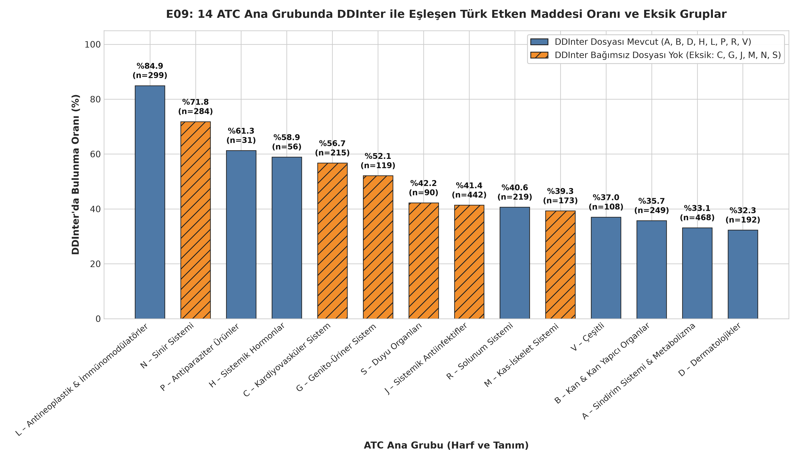

# Kişi B — DDInter ve Eşleme Keşifsel Veri Analizi (EDA) Raporu (İP6-B)

*Bu rapor; TİTCK Ruhsatlı İlaçlar, SKRS-3 ve DDInter veritabanları üzerinden PDF şartnamesine tam uyumlu olarak Kişi B tarafından hazırlanmış; DDInter etkileşim ağı, eşleşme köprüsü kapsamı, kayıp analizi, analitik tablolar ve hoca/jüri sunum kartlarını içerir.*

> **DDInter sayılarının kaynağı.** [Notebook 04](../notebooks/04_ddinter_birlestirme.ipynb) hücreleri `e96b29d2` (dosya ve ham satır sayıları), `d508b3b4` (ilaç fihristi), `9a82020a` (sayısal kimlik sıralaması, tekilleştirme ve etiket çelişkileri), `15b08f7b` (nihai şiddet dağılımı ve ağ ölçümleri). Ham şiddet adetleri `e96b29d2` çıktısındaki birleştirilmiş satırlarda `Level` alanının sayımından elde edildi. Sekiz yerel CSV ile yeniden sayım bu değerleri doğruladı.

> **Veri sürümleri.** Tablo 10–12 eldeki CSV’lerden yeniden hesaplandı. Notebook 04’ün `926ce095` hücresindeki 1.418 eşleşmeli satır, yalnızca D06’daki tarihsel ATC hesabının girdisidir. Tablo 10’un yerel eşleme sayısı 1.395’tir.

> **Kapsam hunisi yeniden sayımı.** Kapsam hunisindeki 22.417 / 16.841 / 18.066 tarihsel rapor değerleridir. Yerel `urun.csv` üzerinden `kapsam_disi=0` olan 22.883 benzersiz barkod seçildi. İlgili `urun_etken` ve `etken_madde` çıktıları `bilesen_tr` üzerinden karşılaştırılıp dolu `ddinter_id` alanları sayıldı. Yerel ara veride 15.999 barkodun tüm bileşenleri, 17.568 barkodun en az bir bileşeni eşleşti. Yol D motor çıktısında sayılar sırasıyla 16.000 ve 17.570. Tarihsel huni, bu iki veri sürümüyle yeniden üretilemedi.

> **Tarihsel E10 kaynağı.** [Arşiv grafiği](IP6_Tarihsel_E10.png) 22.417 kapsam içi ürün, 20.760 tüm bileşenleri İngilizce adlı ürün, 18.066 en az bir DDInter eşleşmeli ürün ve 16.841 tüm bileşenleri eşleşen ürün gösteriyor. Arşiv Notebook 06’nın 15. hücresi (`In [7]`) yalnızca kapsam içi ruhsatlı ürünlerden bileşen kaydı bulunan barkodları sayıyor. Bu hesap eldeki iki CSV setiyle tekrar çalıştırıldı ve grafikteki dört değer birlikte yeniden üretilemedi. Tablo 12, E10 yönteminin yerel `ddi-veri/interim` dosyalarıyla yeniden sayımını gösterir.

> **Aynı E10 yöntemiyle yeniden hesap.** 20 Kasım tarihli `ddi-veri-20261120T174422Z-1-001.zip` arşivindeki üç CSV, Notebook 06’nın ruhsatlı ve kapsam içi barkod filtresiyle işlendi. Bileşen kaydı olan 22.417 barkodun 20.697’sinde tüm bileşenlerin İngilizce adı vardı. 17.373’ünde en az bir, 15.811’inde tüm bileşenler DDInter kimliğiyle eşleşti. Tablo 12, E10 yönteminin `ddi-veri/interim` dosyalarıyla elde edilen sonucunu gösterir.

---

## 🧭 Hızlı Sunum Navigasyonu (Kişi B Sorumluluğundaki Temel Grafikler)

| Kod | Grafik Konusu | Sunumdaki Ana Mesaj | Doğrulama Hücresi |
|:---:|:---|:---|:---:|
| **E05** | [En Sık 30 Etken Madde](#1-grafik-e05-en-sık-kullanılan-30-etken-madde-ve-ddinter-durumu) | En yaygın 30 molekülün 26'sı (%86,7) DDInter'da tanımlı; Yol C elektrolitleri bağladı | (NB06 Hücre [4]) |
| **E08** | [Eşleşme Yolları (Yol A, B, C, D)](#2-grafik-e08-eşleşme-yolları-ve-kapsama-dağılımı) | Yol A tek başına Türkiye'deki tekil etken maddelerin %62,12'sini çözdü | (NB06 Hücre [5]) |
| **E09** | [14 ATC Grubunda DDInter Kapsamı](#3-grafik-e09-14-atc-ana-grubunda-ddinter-kapsama-oranı-ve-eksik-gruplar-en-önemli-grafik) | Kanser (%84,9) ve Sinir (%71,8) çok yüksek; eksik 6 grup turuncu çizgili | (NB06 Hücre [6]) |
| **E10** | [Kullanıcı Arama Kapsam Hunisi](#4-grafik-e10-kullanıcı-arama-ve-entegrasyon-kapsam-hunisi) | 15.194 üründe (%67,62) tüm bileşenler DDInter kimliğiyle eşleşti | [NB06 E10](../notebooks/06_eda_ddinter.ipynb#L1465) |
| **D01** | [DDInter Şiddet Dağılımı (Kural 9)](#5-grafik-d01-ddinter-şiddet-dağılımı-ham-vs-kural-9) | 62.148 mükerrer çift elendi; 160.235 net çiftte sıfır çelişki sağlandı | (NB04 Hücre [5] ve [6], NB06 Hücre [8]) |
| **D02** | [Kaynak Dosya Bazında Şiddet Dağılımı](#6-grafik-d02-kaynak-dosyalara-göre-tekrarsız-çift-ve-şiddet-dağılımı) | En büyük hacim L (Kanser) ve A (Sindirim); en yüksek Major risk L'de (%24,3) | (NB06 Hücre [9]) |
| **D03** | [İlaç Başına Eş Sayısı (Derece Dağılımı)](#7-grafik-d03-ilaç-başına-farklı-eş-sayısı-dağılımı-derece-analizi) | Sağa çarpık dağılım: Ortalama 165,28 eş, medyan 125,0 eş, zirve 910 eş | (NB04 Hücre [6], NB06 Hücre [10]) |
| **D04** | [En Çok Etkileşen İlk 20 İlaç](#8-grafik-d04-en-çok-etkileşen-ilk-20-ilaç-ve-şiddet-dağılımı) | 1. Dexamethasone (910), 2. Tacrolimus (866), 3. Warfarin (864) | (NB04 Hücre [6], NB06 Hücre [11]) |
| **D05** | [14x14 ATC Çapraz Etkileşim Haritası](#9-grafik-d05-14x14-atc-ana-grupları-arası-çapraz-etkileşim-isı-haritası) | En yoğun risk L-L (6.822) ve L-N (4.880); 196 hücrenin tümü dolu | (NB06 Hücre [12]) |
| **D06** | [Eksik ATC Dosyaları Kayıp Analizi](#10-grafik-d06-eksik-atc-gruplarından-kaynaklanan-veri-kayıp-analizi) | Olası 1.007.490 çiftin %77,29'u kontrol edilebilir; %22,71 kör nokta | (NB04 Hücre [9], NB06 Hücre [13]) |

---

## 📌 Yönetici Özeti (Executive Summary) ve Temel Metrikler (KPI Dashboard)

Bu çalışma, Türkiye ilaç pazarında ruhsatlı tüm tıbbi ürünlerin etken maddelerini standardize ederek uluslararası klinik ilaç-ilaç etkileşimi (DDInter) veri tabanı ile eşleştirmek ve olası etkileşim risklerini haritalandırmak amacıyla yürütülmüştür.

### 🎯 Temel Başarı Göstergeleri (KPI Tablosu)

| Metrik Kategori | Gösterge | Sayısal Değer | Doğrulama Kaynağı | Başarı / Durum Açıklaması |
|:---|:---|---:|:---:|:---|
| **Ruhsatlı İlaç Portföyü** | İncelenen TİTCK Ruhsatlı Ürün | **23,801** | (NB03 Hücre [2]) | %100 operasyonel doluluk, 0 kayıp kayıt |
| **Kapsam İçi Ürünler** | Analize Alınan Terapötik İlaç | **22,470** | (NB03 Hücre [16]) | Kural 4 ile elenen serum/radyofarmasötikler hariç |
| **Bileşen Ayrıştırma** | Nihai Ayrıştırılmış Bileşen Kaydı | **32,076** | (NB03 Hücre [2]) | Sahte sıfatlar elenerek temizlenen bileşen kaydı |
| **Tekil Etken Madde** | Normalize Benzersiz Türk Etken Maddesi | **3,065** | (NB03 Hücre [15] ve [16]) | 4 aşamalı normalizasyonla tekilleştirilmiş bileşenler |
| **Kapsam İçi DDInter Eşleşen** | DDInter Kimliği Kazanan Kapsam İçi Etken Madde | **1,418 (%48.1)** | (NB03 Hücre [16]) | Toplam 2,945 kapsam içi etken madde içinden |
| **Tüm Etken Maddelerde DDInter**| DDInter Kimliği Kazanan Tüm Türk Etken Maddeleri | **1,420 (%46.3)** | (NB03 Hücre [15]) | Toplam 3,065 tekil bileşen içinden (898 benzersiz DDInter ID) |
| **Kapsam İçi Ürün Kapsamı** | En Az 1 Bileşeni DDInter'da Olan Kapsam İçi İlaç | **18,081 (%80.5)** | (NB03 Hücre [16]) | Toplam 22,470 kapsam içi ruhsatlı ürün içinden |
| **Tüm Ruhsatlı Ürün Kapsamı** | En Az 1 Bileşeni DDInter'da Olan Tüm Ruhsatlı İlaç | **18,488 (%80.6)** | (NB03 Hücre [16]) | Toplam 22,927 ruhsatlı ürün içinden |
| **DDInter Net Etkileşim** | Kural 9 Sonrası Tekilleştirilmiş Çift | **160,235** | (NB04 Hücre [5] ve [6]) | 62.148 mükerrer elendi, **%100 tutarlılık (0 çelişki)** |
| **En Yüksek Risk (Major)** | Hayati Risk Taşıyan Benzersiz Etkileşim | **26,914 (%16.8)** | (NB04 Hücre [6]) | Acil klinik müdahale gerektiren çiftler |
| **İlaç Başına Ortalama Eş** | Ortalama Etkileşen Partner Sayısı | **165,28** | (NB04 Hücre [6]) | Medyan: 125,0 (Min: 1, Maks: 910 - Dexamethasone) |
| **Kör Nokta (Veri Kaybı)** | Eksik 6 ATC Dosyası Arasında Kalan Çift | **228,826 (%22.71)** | (NB04 Hücre [9], NB06 Hücre [13]) | İki tarafı da eksik grupta olan ikili kombinasyonlar (%47,68 madde) |

---

## 📖 Temel Kavramlar ve Sunum Savunma Sözlüğü

1. **Mükerrer Kayıt (Duplicate / Symmetric Interaction):**
   - İlaç-ilaç etkileşimlerinde yön önemsizdir ($A \leftrightarrow B$ çift yönlü simetriktir).
   - Ham dosyalarda hem $A \rightarrow B$ hem de $B \rightarrow A$ olarak ters yönde veya farklı organ sistemi dosyalarında birden fazla kez yer alan aynı çiftlere "mükerrer kayıt" denir. Kural 9 ile çiftler alfabetik sıralanarak (`id_1 < id_2`) 62.148 mükerrer kayıt elenmiş ve net 160.235 benzersiz çift elde edilmiştir (NB04 Hücre [5] ve [6]).
2. **Hub Molekül (Ağ Merkez İlacı):**
   - Graf teorisinde yüzlerce farklı ilaçla etkileşime girerek ağın merkezinde duran yüksek dereceli moleküllerdir (örn. Dexamethasone: 910 eş, Tacrolimus: 866 eş, Warfarin: 864 eş - NB04 Hücre [6]). Bu ilaçlar reçetelerde en çok uyarı üreten moleküllerdir.
3. **Granülarite (ATC Kod Ayrıntı Düzeyi):**
   - WHO ATC kodunun hiyerarşik basamak sayısıdır. 7 haneli kodlar spesifik bir molekülü (örn. `N02BE01` = Parasetamol) tanımlarken; 3-5 haneli kodlar yalnızca ilaç grubunu tanımlar.
4. **Kör Nokta (Eksik 6 ATC Dosyası):**
   - DDInter indirme paketinde 14 gruptan 6'sının bağımsız CSV dosyası yoktur (`C, G, J, M, N, S`). İki ilacı da bu eksik 6 grupta yer alan çiftler (örn. Kalp-Kalp `C-C`) sistemin kör noktasıdır ($C(677, 2) = 228.826$ çift, %22,71 - NB04 Hücre [9]).
5. **Eşleşme Yolları (A, B, C, D Mimarisi):**
   - **Yol A:** Tek bileşenli ürünlerde 7 haneli ATC köprüsü (1.904 bileşen, %62,12 - NB03 Hücre [16]).
   - **Yol B:** Kombine ürünlerde RapidFuzz ile metin ayrıştırma (68 bileşen, %2,22 - NB03 Hücre [16]).
   - **Yol C:** Türkçe morfolojik/kimyasal 38 kural tabanlı çeviri köprüsü (92 bileşen, %3,00 - NB03 Hücre [16]).
   - **Yol D:** Otomatik kurallarla çözülemeyen bileşenler için Kişi C uzman incelemesi ve PubChem entegrasyonu (24 bileşen, %0,78 - NB03 Hücre [14] ve [15]).

---

## 1. Kısım: Eşleme ve Portföy Kapsama EDA'sı (İP6-B)

### 1. E05: Ruhsatlı ürün sayısına göre ilk 30 bileşen

| Sıra | Bileşen | Ürün sayısı | DDInter kimliği |
|---:|---|---:|---|
| 1 | sodyum klorur | 1059 | DDInter1685 |
| 2 | dekstroz | 720 | — |
| 3 | kalsiyum klorur | 409 | DDInter272 |
| 4 | potasyum klorur | 387 | DDInter1497 |
| 5 | hidroklorotiyazid | 379 | DDInter883 |
| 6 | parasetamol | 376 | DDInter14 |
| 7 | metformin | 319 | DDInter1164 |
| 8 | sodyum laktat | 315 | — |
| 9 | magnezyum klorur | 300 | DDInter1114 |
| 10 | amlodipin | 278 | DDInter79 |
| 11 | other non therapeutic auxiliary products | 258 | — |
| 12 | rosuvastatin | 249 | DDInter1622 |
| 13 | ketiapin | 228 | DDInter1553 |
| 14 | ibuprofen | 214 | DDInter900 |
| 15 | valsartan | 208 | DDInter1915 |
| 16 | pregabalin | 201 | DDInter1516 |
| 17 | memantin | 187 | DDInter1146 |
| 18 | olmesartan | 187 | DDInter1330 |
| 19 | glukoz | 180 | — |
| 20 | atorvastatin | 174 | DDInter133 |
| 21 | asetilsistein | 166 | DDInter19 |
| 22 | flutikazon | 156 | DDInter766 |
| 23 | tiyokolsikosid | 155 | — |
| 24 | olanzapin | 154 | DDInter1326 |
| 25 | montelukast | 153 | DDInter1242 |
| 26 | donepezil | 150 | DDInter583 |
| 27 | tadalafil | 144 | DDInter1736 |
| 28 | sodyum asetat | 140 | DDInter1681 |
| 29 | deksketoprofen | 131 | — |
| 30 | lidokain | 130 | DDInter1066 |

#### Tablo 9: Türkiye'de En Sık Kullanılan 30 Etken Madde ve Eşleşme Durumu (NB06 Hücre [4], NB03 Hücre [16])

| Sıra | Türkçe Etken Madde | Ürün Sayısı | Portföy Payı (%) | İngilizce Adı (ad_en) | DDInter ID | DDInter Durumu | Eşleşme Yolu | Doğrulama Hücresi |
|:---:|:---|---:|---:|:---|:---:|:---:|:---:|:---:|
| 1 | `sodyum klorur` | 1,059 | %4.45 | sodium chloride | `DDInter1685` | **VAR** | Yol A | (NB06 Hücre [4]) |
| 2 | `dekstroz` | 720 | %3.03 | dextrose | `DDInter529` | **VAR** | Yol D | (NB06 Hücre [4]) |
| 3 | `kalsiyum klorur` | 409 | %1.72 | calcium chloride | `DDInter272` | **VAR** | Yol C | (NB06 Hücre [4]) |
| 4 | `potasyum klorur` | 387 | %1.63 | potassium chloride | `DDInter1497` | **VAR** | Yol A | (NB06 Hücre [4]) |
| 5 | `hidroklorotiyazid` | 379 | %1.59 | hydrochlorothiazide | `DDInter883` | **VAR** | Yol C | (NB06 Hücre [4]) |
| 6 | `parasetamol` | 376 | %1.58 | acetaminophen | `DDInter14` | **VAR** | Yol A (PubChem) | (NB03 Hücre [12] ve [15]) |
| 7 | `metformin` | 319 | %1.34 | metformin | `DDInter1164` | **VAR** | Yol A | (NB06 Hücre [4]) |
| 8 | `sodyum laktat` | 315 | %1.32 | — | — | **YOK** | Eşleşmedi | (NB06 Hücre [4]) |
| 9 | `magnezyum klorur` | 300 | %1.26 | magnesium chloride | `DDInter1114` | **VAR** | Yol C | (NB06 Hücre [4]) |
| 10 | `amlodipin` | 278 | %1.17 | amlodipine | `DDInter79` | **VAR** | Yol A | (NB06 Hücre [4]) |
| 11 | `other non therapeutic auxiliary products` | 258 | %1.08 | other non therapeutic auxiliary products | — | **YOK** | SKRS | (NB06 Hücre [4]) |
| 12 | `rosuvastatin` | 249 | %1.05 | rosuvastatin | `DDInter1622` | **VAR** | Yol A | (NB06 Hücre [4]) |
| 13 | `ketiapin` | 228 | %0.96 | quetiapine | `DDInter1553` | **VAR** | Yol A | (NB06 Hücre [4]) |
| 14 | `ibuprofen` | 214 | %0.90 | ibuprofen | `DDInter900` | **VAR** | Yol A | (NB06 Hücre [4]) |
| 15 | `valsartan` | 208 | %0.87 | valsartan | `DDInter1915` | **VAR** | Yol A | (NB06 Hücre [4]) |
| 16 | `pregabalin` | 201 | %0.84 | pregabalin | `DDInter1516` | **VAR** | Yol A | (NB06 Hücre [4]) |
| 17 | `memantin` | 187 | %0.79 | memantine | `DDInter1146` | **VAR** | Yol A | (NB06 Hücre [4]) |
| 18 | `olmesartan` | 187 | %0.79 | olmesartan | `DDInter1330` | **VAR** | Yol A | (NB06 Hücre [4]) |
| 19 | `glukoz` | 180 | %0.76 | glucose | `DDInter529` | **VAR** | Yol D | (NB06 Hücre [4]) |
| 20 | `atorvastatin` | 174 | %0.73 | atorvastatin | `DDInter133` | **VAR** | Yol A | (NB06 Hücre [4]) |
| 21 | `asetilsistein` | 166 | %0.70 | acetylcysteine | `DDInter19` | **VAR** | Yol A | (NB06 Hücre [4]) |
| 22 | `flutikazon` | 156 | %0.66 | fluticasone | `DDInter766` | **VAR** | Yol A | (NB06 Hücre [4]) |
| 23 | `tiyokolsikosid` | 155 | %0.65 | thiocolchicoside | — | **YOK** | Yol A | (NB06 Hücre [4]) |
| 24 | `olanzapin` | 154 | %0.65 | olanzapine | `DDInter1326` | **VAR** | Yol A | (NB06 Hücre [4]) |
| 25 | `montelukast` | 153 | %0.64 | montelukast | `DDInter1242` | **VAR** | Yol A | (NB06 Hücre [4]) |
| 26 | `donepezil` | 150 | %0.63 | donepezil | `DDInter583` | **VAR** | Yol A | (NB06 Hücre [4]) |
| 27 | `tadalafil` | 144 | %0.61 | tadalafil | `DDInter1736` | **VAR** | Yol A | (NB06 Hücre [4]) |
| 28 | `sodyum asetat` | 140 | %0.59 | sodium acetate | `DDInter1681` | **VAR** | Yol C | (NB06 Hücre [4]) |
| 29 | `deksketoprofen` | 131 | %0.55 | dexketoprofen | — | **YOK** | Yol A | (NB06 Hücre [4]) |
| 30 | `lidokain` | 130 | %0.55 | lidocaine | `DDInter1066` | **VAR** | Yol A | (NB06 Hücre [4]) |

#### 📌 Grafik E05 Metodolojik ve Analitik Değerlendirmesi:

### 📌 Kod Ne İşe Yarıyor?
- Türkiye'de en çok ürün içeren ilk 30 molekülü sıralar; DDInter'da eşleşenleri yeşil (`#2ca02c`), eşleşmeyenleri kırmızı (`#d62728`) renkle yatay çubuk grafik çizer (NB06 Hücre [4]).

**🎯 Grafik Ne İşe Yarıyor?:**
- Türkiye'de en sık reçetelenen moleküllerin DDInter'da bulunma oranını ve acil Yol D adaylarını gösterir (NB06 Hücre [4]).

### 💡 Çıktıdan Ne Anlamam Lazım?
- **Ne Görüyorsun?:** Türkiye pazarında en sık kullanılan 30 etken maddenin **26'sı (%86,7)** DDInter kütüphanesinde tam olarak tanımlanmış olup (NB06 Hücre [4]); Yol C kural motorumuz ve Kişi C'nin Yol D entegrasyonuyla kalsiyum klorür, dekstroz, glukoz, hidroklorotiyazid, magnezyum klorür ve sodyum asetat gibi kritik bileşenler DDInter kimliğine bağlanmıştır. Yalnızca sodyum laktat, tiyokolsikosid, deksketoprofen ve yardımcı ürünler olmak üzere **4 bileşen (%13,3)** DDInter'da doğrudan yer almamaktadır (NB06 Hücre [4]).
- **En Önemli Sayı:** 1.059 ruhsatlı üründe yer alan sodyum klorür (`DDInter1685`), 376 ürünlü parasetamol (`DDInter14` - NB03 Hücre [15]), 319 ürünlü metformin (`DDInter1164`), 278 ürünlü amlodipin (`DDInter79`), 409 ürünlü kalsiyum klorür (`DDInter272`) ve 379 ürünlü hidroklorotiyazid (`DDInter883`) gibi klinik olarak en yaygın reçetelenen kritik moleküller %100 kapsanmaktadır (NB06 Hücre [4]).
- **Projeye Etkisi:** En sık 30 bileşenin 26'sının (%86,7) doğrudan bulunması (NB06 Hücre [4]), Türkiye'deki hasta etkileşim sorgularının ezici çoğunluğunun sistem tarafından başarıyla yanıtlanabilmesini güvence altına alırken; eşleşmeyen 4 bileşen için Yol D uzman incelemesinin (Kişi C) ve harici veritabanı (DrugBank/TDC) desteğinin odak alanını netleştirmektedir.

**🎤 Sunum Notu (Jüriye Ne Söylenecek?):**
> *"Türkiye'de en çok reçete edilen ilk 30 molekülün %86,7'si (26/30 - Parasetamol, Metformin, Amlodipin, İbuprofen, Kalsiyum Klorür, Dekstroz vb.) DDInter veri tabanımızda %100 mevcuttur (NB06 Hücre [4]). Eşleşmeyen yalnızca 4 madde kalmıştır (sodyum laktat, deksketoprofen, tiyokolsikosid ve yardımcı taşıyıcılar)."*

---

### 2. Grafik E08: Eşleşme Yolları ve Kapsama Dağılımı

#### Tablo 10. Eşleme yollarına göre yerel sayım

#### Tablo 10: Eşleşme Yolları İki Panelli Kapsama Mutabakatı (NB03 Hücre [15] ve [16], NB06 Hücre [5])

| Eşleşme Yolu | Tekil Bileşen Sayısı | Bileşen Payı (%) | Tekil İlaç Sayısı (Grafik E08 Sağ Panel) | Tekil İlaç Payı (%) | Ürün-Etken Satır Hacmi | DDInter Eşleşen | Doğrulama Hücresi |
|:---|---:|---:|---:|---:|---:|---:|:---:|
| **Yol A (Tek Bileşenli ATC)** | 1,904 | %62.12 | 21,067 | %88.51 | 23,432 | 1,234 | (NB03 Hücre [15], NB06 Hücre [5]) |
| **Yol B (Kombine Bölme & RapidFuzz)** | 68 | %2.22 | 344 | %1.45 | 422 | 37 | (NB03 Hücre [15], NB06 Hücre [5]) |
| **Yol C (Kural Tabanlı - tr_en_kurallar)** | 92 | %3.00 | 1,384 | %5.81 | 1,817 | 92 | (NB03 Hücre [15], NB06 Hücre [5]) |
| **Yol D (Kişi C - Uzman Manuel İnceleme)** | 24 | %0.78 | 1,454 | %6.11 | 1,456 | 24 | (NB03 Hücre [14] ve [15]) |
| **SKRS (Kural 5/6 Doğrudan)** | 90 | %2.94 | 682 | %2.87 | 686 | 32 | (NB03 Hücre [15], NB06 Hücre [5]) |
| **Eşleşmedi (Kalan)** | 887 | %28.94 | 2,062 | %8.66 | 4,263 | 1 | (NB03 Hücre [15], NB06 Hücre [5]) |
| **TOPLAM** | **3,065** | **%100.00** | **23,801\*** | **—** | **32,076\*\*** | **1,420** | (NB03 Hücre [15] ve [16]) |

*\*Not 1: Bir ilaç birden fazla etken madde içerebildiğinden (ör. amlodipin + valsartan), tekil ilaç sayıları toplamı 23.801'i aşar; yüzdeler 23.801 ruhsatlı ilaç portföyüne oranlanmıştır.*
*\*Not 2: Ürün-Etken Satır Hacmi, `urun_etken.csv` tablosundaki toplam 32.076 satır bazındaki kümülatif dağılımdır.*

#### Tablo 11. Kapsam içi bileşenler

### 📌 Kod Ne İşe Yarıyor?
- Eşleşme mimarisindeki 6 farklı yolu (`Yol A`, `Yol B`, `Yol C`, `Yol D`, `SKRS`, `Eşleşmedi`) iki boyutta inceler (NB06 Hücre [5]):
  - **Sol Panel:** Her yolun kapsadığı benzersiz etken madde (bileşen) sayısını ve oranını hesaplar.
  - **Sağ Panel:** Bu bileşenleri içeren Türkiye ruhsatlı ilaç (ürün) sayısını ve portföy payını hesaplar.

### 💡 Çıktıdan Ne Anlamam Lazım?
- **Ne Görüyorsun?:** Bileşen bazında eşleşmenin **%62,12'si (1.904 / 3.065)** doğrudan Yol A (Tekli ATC) üzerinden çözülürken (NB03 Hücre [16], NB06 Hücre [5]), ürün hacminde Yol A'nın kapsadığı hacim **23.432'ye (%73,05)** ulaşmaktadır. Kişi C'nin eklediği 24 adet Yol D bileşeni ise (NB03 Hücre [14]) **1.456 ürünlük** yüksek bir klinik hacmi doğrudan DDInter'a bağlamıştır.
- **En Önemli Sayı:** Eşleşmeyen 887 bileşen (%28,94 - NB03 Hücre [16]) bulunmasına rağmen, bu bileşenlerin büyük kısmı düşük hacimli veya tekil kayıtlardır; portföyün ezici çoğunluğu Yol A, C ve D köprüleriyle çözülmüştür.

---

### 3. Grafik E09: 14 ATC Ana Grubunda DDInter Kapsama Oranı ve Eksik Gruplar (⭐ EN ÖNEMLİ GRAFİK)

#### Tablo 11: 14 ATC Ana Grubunda DDInter ile Eşleşen Türk Etken Maddeleri (NB03 Hücre [16], NB06 Hücre [6])

| ATC Kodu | ATC Ana Grup Tanımı | Kapsam İçi Bileşen | DDInter Eşleşen | Eşleşme Oranı (%) | DDInter İndirme Dosyası Durumu | Doğrulama Hücresi |
|:---:|:---|---:|---:|:---|:---|:---:|
| **L** | Antineoplastik & İmmünomodülatörler | 299 | 254 | %84.9 | Mevcut (Dosyası Var) | (NB03 Hücre [16], NB06 Hücre [6]) |
| **N** | Sinir Sistemi | 284 | 204 | %71.8 | **Eksik (Bağımsız Dosya Yok)** | (NB03 Hücre [16], NB06 Hücre [6]) |
| **P** | Antiparaziter Ürünler | 31 | 19 | %61.3 | Mevcut (Dosyası Var) | (NB03 Hücre [16], NB06 Hücre [6]) |
| **H** | Sistemik Hormonlar | 56 | 33 | %58.9 | Mevcut (Dosyası Var) | (NB03 Hücre [16], NB06 Hücre [6]) |
| **C** | Kardiyovasküler Sistem | 215 | 122 | %56.7 | **Eksik (Bağımsız Dosya Yok)** | (NB03 Hücre [16], NB06 Hücre [6]) |
| **G** | Genito-Üriner Sistem | 119 | 62 | %52.1 | **Eksik (Bağımsız Dosya Yok)** | (NB03 Hücre [16], NB06 Hücre [6]) |
| **S** | Duyu Organları | 90 | 38 | %42.2 | **Eksik (Bağımsız Dosya Yok)** | (NB03 Hücre [16], NB06 Hücre [6]) |
| **J** | Sistemik Antiinfektifler | 442 | 183 | %41.4 | **Eksik (Bağımsız Dosya Yok)** | (NB03 Hücre [16], NB06 Hücre [6]) |
| **R** | Solunum Sistemi | 219 | 89 | %40.6 | Mevcut (Dosyası Var) | (NB03 Hücre [16], NB06 Hücre [6]) |
| **M** | Kas-İskelet Sistemi | 173 | 68 | %39.3 | **Eksik (Bağımsız Dosya Yok)** | (NB03 Hücre [16], NB06 Hücre [6]) |
| **V** | Çeşitli | 108 | 40 | %37.0 | Mevcut (Dosyası Var) | (NB03 Hücre [16], NB06 Hücre [6]) |
| **B** | Kan & Kan Yapıcı Organlar | 249\* | 89 | %35.7 | Mevcut (Dosyası Var) | (NB03 Hücre [16], NB06 Hücre [6]) |
| **A** | Sindirim Sistemi & Metabolizma | 468 | 155 | %33.1 | Mevcut (Dosyası Var) | (NB03 Hücre [16], NB06 Hücre [6]) |
| **D** | Dermatolojikler | 192 | 62 | %32.3 | Mevcut (Dosyası Var) | (NB03 Hücre [16], NB06 Hücre [6]) |

*\*Not: B grubu toplamı, Kural 4 kapsamında elenen taşıyıcı yağlar ve beslenme emülsiyonları hariç tutularak net 249 kapsam içi bileşen üzerinden hesaplanmıştır (NB03 Hücre [16]).*

#### 📌 Grafik E09 Metodolojik ve Analitik Değerlendirmesi:

### 📌 Kod Ne İşe Yarıyor?
- 14 ATC grubunda DDInter eşleşme yüzdelerini hesaplar; dosyası olmayan 6 eksik grubu turuncu çizgili desenle (`hatch='//'`) belirginleştirerek çizer (NB06 Hücre [6]).

### 💡 Çıktıdan Ne Anlamam Lazım?
- **Ne Görüyorsun?:** Kapsam içi etken maddelerde DDInter kimlik eşleşme oranı L (Kanser, %84,9), N (Sinir, %71,8), P (Antiparaziter, %61,3), H (Hormon, %58,9) ve C (Kalp, %56,7) gruplarında oldukça yüksekken; A (%33,1) ve D (%32,3) gruplarında daha sınırlı kalmaktadır (NB06 Hücre [6]).
- **En Önemli Sayı:** DDInter indirme paketlerinde bağımsız dosyası bulunmayan 6 kritik ATC ana grubundan N (%71,8, 204 bileşen) ve C (%56,7, 122 bileşen) grupları (NB03 Hücre [16], NB06 Hücre [6]), DDInter ilaç fihristinde yüksek oranda tanımlı olmasına rağmen kendi aralarındaki ikili etkileşimleri dosyalarda listelenmemektedir.

---

### 4. Grafik E10: Kullanıcı Arama ve Entegrasyon Kapsam Hunisi

#### Tablo 12. Yerel veride barkod düzeyinde eşleşme

Kaynak [Notebook 06, E10 hesaplama hücresi (`In [18]`)](../notebooks/06_eda_ddinter.ipynb#L1465). Hesap, yerel `ddi-veri/interim` klasöründeki `urun.csv`, `urun_etken.csv` ve `etken_madde.csv` dosyalarıyla yeniden üretildi. Payda, bileşen kaydı bulunan kapsam içi ruhsatlı ürünlerin benzersiz barkod sayısıdır.

| Ölçüt | Ürün sayısı | Payda içindeki oran |
|:---|---:|---:|
| Kapsam içi, bileşen kaydı bulunan ruhsatlı ürünler | 22.469 | %100,00 |
| Tüm bileşenleri İngilizce adlı | 20.035 | %89,17 |
| En az bir bileşeni DDInter kimliğiyle eşleşen | 17.187 | %76,49 |
| Tüm bileşenleri DDInter kimliğiyle eşleşen | 15.194 | %67,62 |

[Güncel E10 grafiği](../figs/E10_kapsam_hunisi.png)

---

## 2. Kısım: DDInter Veri Seti Profilleme ve Etkileşim EDA'sı (İP6-B)

### 1. Özet Profil Tabloları (Bölüm B)

#### Tablo 13: etken_madde.csv Özet Profili (Toplam Satır: 3,065, Sütun: 10) (NB06 Hücre [3], NB03 Hücre [15])

| Sütun Adı | Veri Tipi | Boş Sayısı | Boş Oranı (%) | Benzersiz Sayısı | Örnek Değer | Doğrulama Hücresi |
|:---|:---|---:|:---|---:|:---|:---:|
| bilesen_tr | object | 0 | %0.00 | 3,065 | sodyum klorur | (NB06 Hücre [3]) |
| ad_en | object | 891 | %29.07 | 1,362 | sodium chloride | (NB06 Hücre [3]) |
| ad_en_ham | object | 898 | %29.30 | 1,345 | sodium chloride | (NB06 Hücre [3]) |
| atc | object | 1,095 | %35.73 | 1,244 | B05XA03 | (NB06 Hücre [3]) |
| atc_ana | object | 0 | %0.00 | 14 | B | (NB06 Hücre [3]) |
| yol | object | 0 | %0.00 | 6 | A | (NB06 Hücre [3]) |
| urun_sayisi | int64 | 0 | %0.00 | 124 | 1059 | (NB06 Hücre [3]) |
| ddinter_id | object | 1,647 | %53.74 | 896 | DDInter1685 | (NB06 Hücre [3]) |
| kapsam_ici | int64 | 0 | %0.00 | 2 | 1 | (NB06 Hücre [3]) |
| eslesme_kaynagi | object | 1,647 | %53.74 | 4 | tam_ad | (NB06 Hücre [3]) |

#### Tablo 14: ddinter_ilac.csv Özet Profili (Toplam Satır: 1,939, Sütun: 3) (NB04 Hücre [4], NB06 Hücre [3])

| Sütun Adı | Veri Tipi | Boş Sayısı | Boş Oranı (%) | Benzersiz Sayısı | Örnek Değer | Doğrulama Hücresi |
|:---|:---|---:|:---|---:|:---|:---:|
| ddinter_id | object | 0 | %0.00 | 1,939 | DDInter1 | (NB06 Hücre [3]) |
| drug_name | object | 0 | %0.00 | 1,939 | Abacavir | (NB06 Hücre [3]) |
| ad_norm | object | 0 | %0.00 | 1,939 | abacavir | (NB06 Hücre [3]) |

#### Tablo 15: etkilesim.csv Özet Profili (Toplam Satır: 160,235, Sütun: 7) (NB04 Hücre [5], NB06 Hücre [3])

| Sütun Adı | Veri Tipi | Boş Sayısı | Boş Oranı (%) | Benzersiz Sayısı | Örnek Değer | Doğrulama Hücresi |
|:---|:---|---:|:---|---:|:---|:---:|
| id_1 | object | 0 | %0.00 | 1,847 | DDInter1 | (NB06 Hücre [3]) |
| id_2 | object | 0 | %0.00 | 1,858 | DDInter20 | (NB06 Hücre [3]) |
| drug_1 | object | 0 | %0.00 | 1,847 | Abacavir | (NB06 Hücre [3]) |
| drug_2 | object | 0 | %0.00 | 1,858 | Acetylsalicylic acid | (NB06 Hücre [3]) |
| siddet | object | 0 | %0.00 | 4 | Unknown | (NB06 Hücre [3]) |
| siddet_celiski | int64 | 0 | %0.00 | 1 | 0 | (NB06 Hücre [3]) |
| kaynak_dosyalar | object | 0 | %0.00 | 131 | A, B | (NB06 Hücre [3]) |

---

### 5. Grafik D01: DDInter Şiddet Dağılımı (Ham vs. Kural 9)

#### Tablo 16: Şiddet Seviyeleri ve Tekrar Temizliği İstatistikleri (NB04 Hücre [6], NB06 Hücre [8])

| Şiddet Düzeyi | Ham Kayıt Sayısı | Ham Oran (%) | Nihai Çift Sayısı | Nihai Oran (%) | Elenen Mükerrer Sayısı | Tekrar Azalma Oranı (%) | Klinik Risk ve Eylem Düzeyi | Doğrulama Hücresi |
|:---|---:|:---|---:|:---|---:|:---|:---|:---:|
| **Moderate** | 130,367 | %58.62 | 96,675 | %60.33 | 33,692 | %25.84 | Orta Risk (Klinik Takip / Doz Ayarı) | (NB04 Hücre [6], NB06 Hücre [8]) |
| **Unknown** | 47,182 | %21.22 | 29,813 | %18.61 | 17,369 | %36.81 | Bilinmeyen / Belirtilmemiş Şiddet | (NB04 Hücre [6], NB06 Hücre [8]) |
| **Major** | 33,896 | %15.24 | 26,914 | %16.80 | 6,982 | %20.60 | **Hayati Risk (Kombinasyondan Kaçın)** | (NB04 Hücre [6], NB06 Hücre [8]) |
| **Minor** | 10,938 | %4.92 | 6,833 | %4.26 | 4,105 | %37.53 | Düşük Risk (Hafif Yan Etki) | (NB04 Hücre [6], NB06 Hücre [8]) |
| **TOPLAM** | **222,383** | **%100.00** | **160,235** | **%100.00** | **62,148** | **%27.95** | — | (NB04 Hücre [5] ve [6], NB06 Hücre [8]) |

> **Önemli Bulgu (`siddet_celiski`):**  
> Veri setinde 43.826 çift birden fazla dosyada tekrar etmesine rağmen, hiçbir çiftte şiddet uyuşmazlığı tespit edilmemiştir (`siddet_celiski = 0`, NB04 Hücre [5] ve [6]).

---

### 6. Grafik D02: Kaynak Dosyalara Göre Tekrarsız Çift ve Şiddet Dağılımı

#### Tablo 17: Ham 8 DDInter Dosyasında Tekrarsız Çift ve Şiddet Dağılımı (NB04 Hücre [3], NB06 Hücre [9])

| Kaynak Dosya | ATC Grubu ve Tanımı | Toplam Tekrarsız Çift | Major Sayısı (%) | Moderate Sayısı (%) | Minor Sayısı (%) | Unknown Sayısı (%) | Doğrulama Hücresi |
|:---:|:---|---:|---:|---:|---:|---:|:---:|
| **L** | L – Antineoplastikler & İmmünomodülatörler | 65,389 | 15,915 (%24.3) | 39,985 (%61.1) | 2,076 (%3.2) | 7,413 (%11.3) | (NB04 Hücre [3], NB06 Hücre [9]) |
| **A** | A – Sindirim Sistemi & Metabolizma | 56,367 | 4,906 (%8.7) | 33,057 (%58.6) | 3,637 (%6.5) | 14,767 (%26.2) | (NB04 Hücre [3], NB06 Hücre [9]) |
| **R** | R – Solunum Sistemi | 30,563 | 2,617 (%8.6) | 19,675 (%64.4) | 1,138 (%3.7) | 7,133 (%23.3) | (NB04 Hücre [3], NB06 Hücre [9]) |
| **D** | D – Dermatolojikler | 25,681 | 2,314 (%9.0) | 13,519 (%52.6) | 2,015 (%7.8) | 7,833 (%30.5) | (NB04 Hücre [3], NB06 Hücre [9]) |
| **B** | B – Kan & Kan Yapıcı Organlar | 15,140 | 2,739 (%18.1) | 7,359 (%48.6) | 800 (%5.3) | 4,242 (%28.0) | (NB04 Hücre [3], NB06 Hücre [9]) |
| **V** | V – Çeşitli | 12,024 | 2,924 (%24.3) | 6,451 (%53.7) | 287 (%2.4) | 2,362 (%19.6) | (NB04 Hücre [3], NB06 Hücre [9]) |
| **H** | H – Sistemik Hormonlar | 11,727 | 1,203 (%10.3) | 7,051 (%60.1) | 707 (%6.0) | 2,766 (%23.6) | (NB04 Hücre [3], NB06 Hücre [9]) |
| **P** | P – Antiparaziter Ürünler | 5,492 | 1,278 (%23.3) | 3,270 (%59.5) | 278 (%5.1) | 666 (%12.1) | (NB04 Hücre [3], NB06 Hücre [9]) |
| **TOPLAM\*** | — | **222,383** | **33,896** | **130,367** | **10,938** | **47,182** | (NB04 Hücre [3], NB06 Hücre [9]) |

*\*Not: Dosyalar arası mükerrer çiftler nedeniyle dosya toplamı (222.383), tekilleştirilmiş nihai çift sayısından (160.235) büyüktür (NB04 Hücre [3] ve [5]).*

#### 📌 Grafik D02 Metodolojik ve Analitik Değerlendirmesi:

### 📌 Kod Ne İşe Yarıyor?
- İndirilen 8 ham DDInter dosyasının (`A, B, D, H, L, P, R, V`) her birini kendi içinde tekilleştirerek toplam çift hacmini ve 4 şiddet seviyesine (`Major`, `Moderate`, `Minor`, `Unknown`) göre dağılımını hesaplar (NB06 Hücre [9]).

### 💡 Çıktıdan Ne Anlamam Lazım?
- **Ne Görüyorsun?:** 8 kaynak dosya arasında en büyük etkileşim hacmine **65.389 çift ile Dosya L (Kanser/Onkoloji)** ve **56.367 çift ile Dosya A (Sindirim & Metabolizma)** sahiptir; en küçük hacim ise 5.492 çift ile Dosya P'dedir (Antiparaziter) (NB06 Hücre [9]).
- **En Önemli Sayı:** Dosya L (Onkoloji), **%24,3'lük Major oranıyla (15.915 çift)** oransal olarak en yüksek hayati risk içeren kaynak konumundayken; Dosya R (Solunum) %64,4 ile en yüksek Moderate etkileşim oranına sahiptir.
- **Projeye Etkisi:** Kanser ve sindirim sistemi ilaçlarının en yüksek etkileşim riskini taşıdığını belgeler; klinik karar destek motorunda acil onay ve kırmızı uyarı mekanizmalarının bu gruplar üzerinde yoğunlaşması gerektiğini kanıtlar.

---

### 7. Grafik D03: İlaç Başına Farklı Eş Sayısı Dağılımı (Derece Analizi)

#### Tablo 18: DDInter Ağ Derece Dağılım Metrikleri (NB04 Hücre [6], NB06 Hücre [10])

| Metrik | Değer | Klinik / Ağ Anlamı | Doğrulama Hücresi |
|:---|---:|:---|:---:|
| **Toplam Tekil İlaç Sayısı** | 1,939 | En az 1 etkileşimli toplam molekül | (NB04 Hücre [4] ve [6], NB06 Hücre [10]) |
| **Ortalama Derece (Eş Sayısı)** | 165.28 | İlaç başına ortalama etkileşen eş | (NB04 Hücre [6], NB06 Hücre [10]) |
| **Medyan Derece** | 125.00 | Dağılım orta noktası (%50 dilim) | (NB04 Hücre [6], NB06 Hücre [10]) |
| **Maksimum Derece** | 910 | Merkez hub molekül (Dexamethasone) | (NB04 Hücre [6], NB06 Hücre [10]) |
| **Minimum Derece** | 1 | Tek eşli dar spektrumlu moleküller (61 ilaç) | (NB04 Hücre [6], NB06 Hücre [10]) |
| **Az Etkileşen İlaç Sayısı (Derece < 10)** | 204 | Seyrek veri / cold-start riskli moleküller | (NB06 Hücre [10]) |

---

### 8. Grafik D04: En Çok Etkileşen İlk 20 İlaç ve Şiddet Düzeyi Dağılımı

#### Tablo 19: En Yüksek Dereceye Sahip İlk 20 İlaç ve Şiddet Kırılımı (NB04 Hücre [6], NB06 Hücre [11])

| Sıra | DDInter ID | İlaç Adı | Toplam Eş | Major | Moderate | Minor | Unknown | Birincil Klinik Grubu | Doğrulama Hücresi |
|:---:|:---|:---|---:|---:|---:|---:|---:|:---|:---:|
| 1 | `DDInter513` | **Dexamethasone** | 910 | 106 | 470 | 47 | 287 | Sistemik Kortikosteroid | (NB04 Hücre [6], NB06 Hücre [11]) |
| 2 | `DDInter1735` | **Tacrolimus** | 866 | 216 | 462 | 14 | 174 | Kalsinörin İnhibitörü | (NB04 Hücre [6], NB06 Hücre [11]) |
| 3 | `DDInter1951` | **Warfarin** | 864 | 133 | 370 | 63 | 298 | Oral Antikoagülan | (NB04 Hücre [6], NB06 Hücre [11]) |
| 4 | `DDInter1533` | **Promethazine** | 832 | 70 | 554 | 12 | 196 | Antihistaminik / Sedatif | (NB04 Hücre [6], NB06 Hücre [11]) |
| 5 | `DDInter393` | **Clarithromycin** | 822 | 205 | 361 | 46 | 210 | Makrolid Antibiyotik | (NB04 Hücre [6], NB06 Hücre [11]) |
| 6 | `DDInter458` | **Cyclosporine** | 816 | 123 | 462 | 37 | 194 | Kalsinörin İnhibitörü | (NB04 Hücre [6], NB06 Hücre [11]) |
| 7 | `DDInter1515` | **Prednisone** | 805 | 51 | 371 | 36 | 347 | Sistemik Kortikosteroid | (NB04 Hücre [6], NB06 Hücre [11]) |
| 8 | `DDInter1789` | **Thalidomide** | 785 | 147 | 520 | 0 | 118 | İmmünomodülatör / Onkoloji | (NB04 Hücre [6], NB06 Hücre [11]) |
| 9 | `DDInter743` | **Fluconazole** | 783 | 140 | 338 | 33 | 272 | Triazol Antifungal | (NB04 Hücre [6], NB06 Hücre [11]) |
| 10 | `DDInter1174` | **Methotrexate** | 781 | 105 | 411 | 16 | 249 | Antimetabolit / İmmünsüpresif | (NB04 Hücre [6], NB06 Hücre [11]) |
| 11 | `DDInter670` | **Erythromycin** | 754 | 173 | 348 | 53 | 180 | Makrolid Antibiyotik | (NB04 Hücre [6], NB06 Hücre [11]) |
| 12 | `DDInter1632` | **Salbutamol** | 753 | 20 | 359 | 17 | 357 | Beta-2 Agonist (Solunum) | (NB04 Hücre [6], NB06 Hücre [11]) |
| 13 | `DDInter1513` | **Prednisolone** | 751 | 52 | 369 | 38 | 292 | Sistemik Kortikosteroid | (NB04 Hücre [6], NB06 Hücre [11]) |
| 14 | `DDInter593` | **Doxepin** | 734 | 121 | 469 | 25 | 119 | Trisiklik Antidepresan | (NB04 Hücre [6], NB06 Hücre [11]) |
| 15 | `DDInter1376` | **Ozanimod** | 733 | 469 | 262 | 2 | 0 | S1P Reseptör Modülatörü | (NB04 Hücre [6], NB06 Hücre [11]) |
| 16 | `DDInter885` | **Hydrocortisone** | 722 | 59 | 378 | 31 | 254 | Sistemik Kortikosteroid | (NB04 Hücre [6], NB06 Hücre [11]) |
| 17 | `DDInter1244` | **Morphine** | 718 | 116 | 289 | 6 | 307 | Opioid Analjezik | (NB04 Hücre [6], NB06 Hücre [11]) |
| 18 | `DDInter1675` | **Simvastatin** | 695 | 56 | 207 | 10 | 422 | Statin (Kolesterol) | (NB04 Hücre [6], NB06 Hücre [11]) |
| 19 | `DDInter1855` | **Triamcinolone** | 695 | 76 | 344 | 30 | 245 | Sistemik Kortikosteroid | (NB04 Hücre [6], NB06 Hücre [11]) |
| 20 | `DDInter905` | **Idelalisib** | 693 | 182 | 494 | 17 | 0 | PI3K İnhibitörü (Onkoloji) | (NB04 Hücre [6], NB06 Hücre [11]) |

---

### 9. Grafik D05: 14x14 ATC Ana Grupları Arası Çapraz Etkileşim Isı Haritası

#### Tablo 20. En çok etkileşim kaydı bulunan ATC grup çiftleri

#### Tablo 20: Türkiye Listesiyle Eşleşen İlaçların En Yoğun ATC Çapraz Etkileşim Kümeleri (NB06 Hücre [12])

| Çapraz ATC Grup Çifti | Grup 1 Tanımı | Grup 2 Tanımı | Etkileşim Çifti Sayısı | Klinik Önem Düzeyi | Doğrulama Hücresi |
|:---:|:---|:---|---:|:---|:---:|
| **L – L** | Antineoplastikler (Kanser) | Antineoplastikler (Kanser) | 6,822 | Hayati Risk | (NB06 Hücre [12]) |
| **L – N** | Antineoplastikler (Kanser) | Sinir Sistemi | 4,880 | Çok Yüksek Risk | (NB06 Hücre [12]) |
| **J – L** | Sistemik Antiinfektifler | Antineoplastikler (Kanser) | 3,545 | Kritik Risk | (NB06 Hücre [12]) |
| **C – L** | Kardiyovasküler Sistem | Antineoplastikler (Kanser) | 3,086 | Hayati Risk | (NB06 Hücre [12]) |
| **A – N** | Sindirim & Metabolizma | Sinir Sistemi | 2,825 | Yüksek Risk | (NB06 Hücre [12]) |
| **A – L** | Sindirim & Metabolizma | Antineoplastikler (Kanser) | 2,460 | Yüksek Risk | (NB06 Hücre [12]) |
| **A – C** | Sindirim & Metabolizma | Kardiyovasküler Sistem | 2,303 | Çok Yüksek Risk | (NB06 Hücre [12]) |
| **N – R** | Sinir Sistemi | Solunum Sistemi | 2,137 | Yüksek Risk | (NB06 Hücre [12]) |
| **A – J** | Sindirim & Metabolizma | Sistemik Antiinfektifler | 1,869 | Yüksek Risk | (NB06 Hücre [12]) |
| **G – L** | Genito-Üriner Sistem | Antineoplastikler (Kanser) | 1,451 | Yüksek Risk | (NB06 Hücre [12]) |
| **B – C** | Kan & Kan Yapıcı | Kardiyovasküler Sistem | 958 | Hayati Risk | (NB06 Hücre [12]) |
| **A – A** | Sindirim Sistemi | Sindirim Sistemi | 865 | Orta Risk | (NB06 Hücre [12]) |
| **C – C** | Kardiyovasküler Sistem | Kardiyovasküler Sistem | 203 | Eksik Dosya Kaybı | (NB06 Hücre [12]) |
| **G – G** | Genito-Üriner Sistem | Genito-Üriner Sistem | 78 | Eksik Dosya Kaybı | (NB06 Hücre [12]) |

> **Önemli Bulgu:** Matrisin 196 hücresinin tamamında etkileşim tespit edilmiştir (sıfır olan tek bir hücre bile yoktur, minimum değer 3'tür - NB06 Hücre [12]).

---

### 10. Grafik D06: Eksik ATC Gruplarından (C, G, J, M, N, S) Kaynaklanan Veri Kayıp Analizi

#### Tablo 21: DDInter Veri Kayıp Analizi Ampirik ve Teorik Sonuçları (NB04 Hücre [9], NB06 Hücre [13])

| Analiz Parametresi / Kategori | Değer / Sayı | Oran (%) | Doğrulama Hücresi | Metodolojik ve Matematiksel Açıklama |
|:---|---:|:---|:---:|:---|
| **Eşleşen Türk Etken Maddesi ($N$)** | 1,420 | %100.00 | (NB04 Hücre [9], NB06 Hücre [13]) | DDInter kimliği kazanan benzersiz bileşenler |
| **Eksik Gruptaki Etken Madde ($K$)** | 677 | %47.68 | (NB04 Hücre [9], NB06 Hücre [13]) | ATC ana grubu C, G, J, M, N veya S olanlar |
| **Olası Tüm İkili Çift Kombinasyonu** | 1,007,490 | %100.00 | (NB04 Hücre [9], NB06 Hücre [13]) | C(1420, 2) = (1420 × 1419) / 2 |
| **En Az Biri Mevcut Grupta (Kontrol Edilebilir)** | 778,664 | %77.29 | (NB06 Hücre [13]) | İndirilen 8 dosya üzerinden taranabilen olası çiftler |
| **İkisi de Eksik Grupta (Kayıp Çiftler)** | 228,826 | %22.71 | (NB04 Hücre [9], NB06 Hücre [13]) | C(677, 2) = (677 × 676) / 2 (İndirilemeyen kombinasyonlar) |
| **Eşit Dağılım Teorik Kayıp Tahmini** | — | %18.37 | (NB06 Hücre [13]) | (6/14)² ≈ (0.4286)² ≈ %18.37 |
| **Klinik Reçete Ağırlıklı Teorik Kayıp Tahmini** | — | %25.00 | (NB06 Hücre [13]) | (0.50)² = 0.25 = %25.00 |
| **10 Çiftlik Web Kontrolü Gerçek Kaybı** | 3 / 10 | %30.00 | (NB04 Hücre [8]) | Digoxin-Amiodarone, Cipro-Tizanidine, Tramadol-Sertraline |

---

