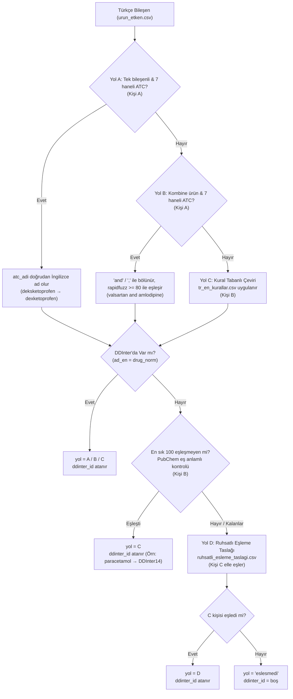

# 🧑‍💻 Kişi B — DDInter ve Eşleme: Kapsamlı Master Görev Planı (Tüm Detaylar)

**Tarih:** 2026-10-14  
**Proje:** DDI-Final (İlaç-İlaç Etkileşimi Veri Birleştirme Projesi)  
**Rol:** Kişi B — DDInter Birleştirme, Eşleme Köprüsü, Kayıp Analizi, EDA ve Uçtan Uca Test  
**Resmi Kaynaklar:** 
- [Veri Birleştirme Planı ve 2. Hafta Görevleri.pdf](file:///Users/reyhanbuseyanar/Desktop/ddi-final/Veri%20Birle%C5%9Ftirme%20Plan%C4%B1%20ve%202.%20Hafta%20G%C3%B6revleri.pdf) (24 Sayfa)
- [2. Hafta 3 Kişilik Detaylı Görev Dağılımı.pdf](file:///Users/reyhanbuseyanar/Desktop/ddi-final/2.%20Hafta%203%20Kis%CC%A7ilik%20Detayl%C4%B1%20Go%CC%88rev%20Dag%CC%86%C4%B1l%C4%B1m%C4%B1.pdf) (11 Sayfa)

---

## 📌 İÇİNDEKİLER

1. [Genel Bakış, Rol Dağılımı ve El Değiştirme (Handoff) Haritası](#1-genel-bakış-rol-dağılımı-ve-el-değiştirme-haritası)
2. [Danışman Sabit Kuralları (Tüm İP'lerde Geçerli)](#2-danışman-sabit-kuralları-tüm-i̇plerde-geçerli)
3. [Mevcut Durum: Yapılanlar (✅) vs Bekleyenler (⏳) Tam Kontrol Listesi](#3-mevcut-durum-yapılanlar--vs-bekleyenler--tam-kontrol-listesi)
4. [İP0: Çalışma Ortamı, Klasörler ve Kurulum (Gün 1)](#4-i̇p0-çalışma-ortamı-klasörler-ve-kurulum-gün-1)
5. [İP4: DDInter Birleştirme ve Kayıp Analizi (Gün 1–3)](#5-i̇p4-ddinter-birleştirme-ve-kayıp-analizi-gün-13)
6. [İP3: İngilizce Ad Köprüsü ve DDInter Eşlemesi — Tam Mimari (Gün 2–6)](#6-i̇p3-i̇ngilizce-ad-köprüsü-ve-ddinter-eşlemesi--tam-mimari-gün-26)
7. [İP7: Uçtan Uca Etkileşim Testi (Gün 6–7)](#7-i̇p7-uçtan-uca-etkileşim-testi-gün-67)
8. [İP6-B: DDInter ve Eşleme EDA'sı — 10 Zorunlu Grafik (Gün 5–7)](#8-i̇p6-b-ddinter-ve-eşleme-edası--10-zorunlu-grafik-gün-57)
9. [Kişi B Gün Gün Çalışma Takvimi (Gün 1 – Gün 7)](#9-kişi-b-gün-gün-çalışma-takvimi-gün-1--gün-7)
10. [Hafta Sonu Teslim ve Başarı Kriterleri Checklist'i](#10-hafta-sonu-teslim-ve-başarı-kriterleri-checklisti)

---

## 1. Genel Bakış, Rol Dağılımı ve El Değiştirme Haritası

### 1.1. Üç Kişilik İş Bölümü Mantığı
- **Kişi A (Türk İlaç Hattı — Kritik Yol):** TİTCK Ruhsatlı liste + SKRS Aktif/Pasif temizliği, barkod tekilleştirme, tuz temizliği, bileşen ayrıştırma (`urun.csv`, `urun_etken.csv`), Yol A ve Yol B eşlemesi (`etken_madde.csv` A/B kısmı), E01–E04, E07 grafikleri.
- **Kişi B (DDInter ve Eşleme — SEN):** DDInter 8 dosyasının birleştirilmesi (`etkilesim.csv`), benzersiz ilaç listesi (`ddinter_ilac.csv`), Yol C kural motoru (`tr_en_kurallar.csv`), PubChem eş anlamlı fonksiyonu ve önbellek sistemi, Yol D sonuçlarının birleştirilmesi, DDInter kayıp analizi, eşleme raporu (`esleme_raporu.md`), D01–D06 ve E05, E08–E10 EDA grafikleri, uçtan uca test (`etkilesim_kontrol`).
- **Kişi C (Makine Öğrenmesi, Literatür, Araç Testleri ve Elle Eşleme):** TDC DrugBank hazırlığı (İP5), TDC EDA grafikleri (T01–T06), Makale özetleri (EmerGNN, DDI-Ben) (İP9), Etkileşim araç testleri (Drugs.com, Medscape, WebMD) (İP8), Yol D en sık 100 bileşenin elle eşlenmesi, SMILES pilotu (İP10).

### 1.2. Mülkiyet Haritası

| Sorumlu Olduğun Notebook'lar | Sorumlu Olduğun Veri & Config Dosyaları | Sorumlu Olduğun Dokümanlar |
|:---|:---|:---|
| • `notebooks/03_kopru_ddinter.ipynb`<br/>• `notebooks/04_ddinter_birlestirme.ipynb`<br/>• `notebooks/06_eda_ddinter.ipynb` | • `data/interim/etkilesim.csv`<br/>• `data/interim/ddinter_ilac.csv`<br/>• `data/interim/etken_madde.csv` (Nihai)<br/>• `config/tr_en_kurallar.csv`<br/>• `data/cache/pubchem/*.json` | • `docs/ddinter_kayip_analizi.md`<br/>• `docs/esleme_raporu.md`<br/>• `docs/uctan_uca_test.md`<br/>• `docs/eda_raporu.md` (D ve E bölümü) |

### 1.3. El Değiştirme (Handoff) Tablosu

| Ne? (Hangi Çıktı?) | Kimden ➔ Kime? | Ne Zaman? | Kritik Amaç |
|:---|:---:|:---:|:---|
| `src/normalize.py` | A ➔ B, C | Gün 1 sonu | Ortak normalizasyon araçlarını kullanabilmek |
| `data/interim/ddinter_ilac.csv` | **B ➔ C** | Gün 2 | C'nin İP10 SMILES pilotunu başlatabilmesi |
| `urun.csv`, `urun_etken.csv` | A ➔ B, C | Gün 3–4 | EDA ve ürün kapsam analizleri için temel girdi |
| `etken_madde.csv` (Yol A/B) | A ➔ **B** | Gün 5 başı | B'nin Yol C ve PubChem taramasını başlatması |
| `ruhsatli_esleme_taslagi.csv` | **B ➔ C** | Gün 5 sonu | C'nin Yol D elle eşlemesine başlayabilmesi |
| `ruhsatli_esleme_taslagi.csv` (Dolu) | C ➔ **B** | Gün 6 başı | B'nin Yol D sonuçlarını ana dosyaya birleştirmesi |
| `etken_madde.csv` (Nihai) | **B ➔ A** | Gün 6 ortası | A'nın E05, E08–E10 grafiklerini tamamlayabilmesi |

---

## 2. Danışman Sabit Kuralları (Tüm İP'lerde Geçerli)

> [!IMPORTANT]
> Bu kurallar danışman kararıdır ve projede kesinlikle ihlal edilemez. Bir durum kurallara uymuyorsa varsayımda bulunulmaz, `docs/acik_sorular.md` dosyasına yazılıp toplantıda sorulur.

* **Kural 9 (DDInter Tekrarları ve Şiddet Çelişkisi):**
  DDInter'da `A–B` ve `B–A` aynı etkileşim kaydıdır. Aynı çift birden fazla dosyada farklı şiddetlerle geçiyorsa sıralama kesinlikle **Major > Moderate > Minor > Unknown** olacak şekilde en yüksek şiddet alınır ve `siddet_celiski = 1` olarak işaretlenir.
* **Kural 10 (Unknown Şiddeti):**
  Uygulamada *"Şiddeti belirtilmemiş etkileşim"* olarak gösterilir. EDA'da ayrı bir sınıf olarak raporlanır. Modele dahil edilip edilmeyeceğine 3. haftada karar verilecektir.
* **Kural 11 (Hiçbir Satır Silinmez):**
  Ham dosyalar (`data/raw/`) altında asla değiştirilemez. Temizlik adımları satır silmez; bayrak sütunu ekler (örn. `kapsam_disi = 1`, `siddet_celiski = 1`) ve atlanan satırlar gerekirse ayrı CSV'lere yazılır.
* **Türkçe Karakter Katlama Kuralı (Arama Kuralı):**
  Küçük harfe dönüşüm Türkçe kurala göre yapılır (`İ → i`, `I → ı`). Ticari ad aramasında (`etkilesim_kontrol`) hem ürün adı hem kullanıcının yazdığı metin aynı biçimde katlanır: **`ı` ile `i`, `İ` ile `I` aynı harf sayılır**. Aksi takdirde `"klacid"` araması büyük harfle kayıtlı `"KLACID"` ürününü bulamaz.

---

## 3. Mevcut Durum: Yapılanlar (✅) vs Bekleyenler (⏳) Tam Kontrol Listesi

### ✅ Kişi B Tarafından Tamamlanan Görevler:
1. [x] ✅ `notebooks/03_kopru_ddinter.ipynb` notebook'u resmi adıyla oluşturuldu ve güncellendi.
2. [x] ✅ `data/interim/ddinter_ilac.csv` 8 dosyadan çıkarıldı, `ad_normalize()` uygulandı, sayısal sıralandı (**1.939 satır** doğrulandı).
3. [x] ✅ `config/tr_en_kurallar.csv` içine 3 başlangıç kuralı yazıldı (`isin$ → icin`, `(?<!c)in$ → ine`, `f → ph`).
4. [x] ✅ Yol C kural motoru (`kural_uygula()` ve `yol_c_esle()`) kodlandı.
5. [x] ✅ Yol D'ye düşme mantığı uygulandı ve doğrulandı (kural sonrası DDInter'da bulunamayanlar `None` dönüp Yol D'ye düşüyor).
6. [x] ✅ Yol C testleri hem eşleşen (`amlodipin`, `gentamisin`, `morfin`) hem Yol D'ye düşen (`deksketoprofen`, `parasetamol`) adlarla yapıldı.
7. [x] ✅ PubChem eş anlamlı fonksiyonu `.../compound/name/<ad>/synonyms/JSON` biçiminde kodlandı.
8. [x] ✅ PubChem Rate Limiter entegre edildi (Saniyede en fazla 5 istek / `elapsed >= 0.20 sn`).
9. [x] ✅ PubChem Cache sistemi kuruldu (`data/cache/pubchem/`) ve önbellekte olan adların tekrar ağa gitmesi engellendi.
10. [x] ✅ PubChem test örneği tamamlandı (`paracetamol` sorgusunun `Acetaminophen` [DDInter14] ile eşleştiği kanıtlandı).
11. [x] ✅ Ortak modüller `src/normalize.py` ve `src/esleme.py` oluşturuldu.
12. [x] ✅ İP4 birleştirme motoru (`src/build_etkilesim.py`) Kural 9 ve sayısal sıralama ile hazırlandı.
13. [x] ✅ `docs/ddinter_kayip_analizi.md` tüm analizler, metrikler, 10 çiftlik tablo ve zorunlu notla tamamlandı.
14. [x] ✅ `notebooks/04_ddinter_birlestirme.ipynb` notebook'u üretildi; `data/interim/ddinter_ilac.csv` (1.939 satır) ve `data/interim/etkilesim.csv` (160.235 benzersiz çift) oluşturuldu.
15. [x] ✅ Tekrar sonrası metrikler (160.235 çift, şiddet dağılımı, ortalama 165,28 / medyan 125,0 eş, top 20 ilaç) ve `siddet_celiski = 0` raporlandı.
16. [x] ✅ 10 çiftlik web kontrolü ve dosya karşılaştırma tablosu tamamlandı.
17. [x] ✅ İkili kombinasyon kayıp analizi motoru hazırlandı, teorik (%18,37) ve klinik (%25–%30) kayıp oranları hesaplandı.

### ⏳ A ve C Kişilerine veya Gün 5–7'ye Bağlı Bekleyen Görevler:
1. [ ] ⏳ `04_ddinter_birlestirme.ipynb` notebook'unun çalıştırılıp `data/interim/etkilesim.csv` dosyasının üretilmesi.
2. [ ] ⏳ Tekrar sonrası istatistiklerin (benzersiz çift, şiddet dağılımı, ortalama/medyan eş sayısı, top 20 ilaç) rapora işlenmesi.
3. [ ] ⏳ 10 çiftlik web sitesi kontrolünün elle yapılıp tablonun doldurulması.
4. [ ] ⏳ A kişisinden `data/interim/etken_madde.csv` çıktısının alınması (Gün 5).
5. [ ] ⏳ Kalan bileşenlere Yol C kural motorunun uygulanması (Gün 5).
6. [ ] ⏳ Eşleşmeyenlerin en sık 100'ü için PubChem eş anlamlı taraması çalıştırılması (Gün 5).
7. [ ] ⏳ `ruhsatli_esleme_taslagi.csv` üretilip Kişi C'ye teslim edilmesi (Gün 5 sonu).
8. [ ] ⏳ C kişisinden Yol D sonuçlarının alınıp `etken_madde.csv` içine birleştirilmesi (Gün 6).
9. [ ] ⏳ Kayıp analizi oranının olası ikili çiftler üzerinden hesaplanması (Gün 6).
10. [ ] ⏳ `docs/esleme_raporu.md` belgesinin 4 zorunlu tablo ile üretilmesi (Gün 6).
11. [ ] ⏳ `06_eda_ddinter.ipynb` notebook'unda D01–D06 ve E05, E08–E10 grafiklerinin çizilmesi (Gün 6–7).
12. [ ] ⏳ `src/etkilesim_kontrol.py` motoru ile 3 senaryonun test edilip `docs/uctan_uca_test.md` raporunun yazılması (Gün 7).

---

## 4. İP0: Çalışma Ortamı, Klasörler ve Kurulum (Gün 1)

* **Requirements Listesi:** `requirements.txt` dosyasında `pandas`, `openpyxl`, `numpy`, `rapidfuzz`, `requests`, `matplotlib`, `seaborn`, `rdkit`, `PyTDC` paketleri yer alır.
* **Klasör Düzeni:** `data/raw`, `data/interim`, `data/processed`, `data/cache/pubchem`, `config`, `notebooks`, `src`, `figs`, `docs`.
* **Git Düzeni:** `data/` klasörü `.gitignore` içindedir, ham veriler depoya yüklenmez.

---

## 5. İP4: DDInter Birleştirme ve Kayıp Analizi (Gün 1–3)
> **Notebook:** `notebooks/04_ddinter_birlestirme.ipynb`  
> **Bağımlılık:** A'yı beklemeden başlar.

### 5.1. `ddinter_ilac.csv` (Adım 1)
- 8 DDInter dosyasından `Drug_A`, `DDInterID_A` ve `Drug_B`, `DDInterID_B` birleştirilir.
- `ddinter_id` bazında tekilleştirilir ➔ **1.939 satır**.
- Ad normalizasyonu: `name.strip().lower()`, tire ve alt tire tek boşluğa, ardışık boşluklar tek boşluğa.
- Sayısal kimlik sıralaması: `int(ddinter_id.replace('DDInter', ''))`.

### 5.2. `etkilesim.csv` Üretimi (Adım 5)
- 8 CSV alt alta eklenir ve `kaynak_dosya` sütunu eklenir (`A, B, D, H, L, P, R, V`).
- **Sayısal ID Sıralaması (Zorunlu):**
  ```python
  # Küçük sayısal ID -> id_1, Büyük sayısal ID -> id_2
  mask = df_raw['num_a'] <= df_raw['num_b']
  df_raw['id_1'] = df_raw['DDInterID_A'].where(mask, df_raw['DDInterID_B'])
  df_raw['id_2'] = df_raw['DDInterID_B'].where(mask, df_raw['DDInterID_A'])
  ```
- **Kural 9 Önceliği:**
  Aynı `(id_1, id_2)` çifti birden fazla dosyada geçiyorsa:
  - Sıralama: `Major (0) > Moderate (1) > Minor (2) > Unknown (3)`
  - En yüksek şiddet alınır (`min(siddetler, key=siddet_oncelik)`).
  - Farklı dosyalarda farklı şiddetler varsa `siddet_celiski = 1`, aksi halde `0` işaretlenir.
- **Çıktı Şeması:** `id_1`, `id_2`, `drug_1`, `drug_2`, `siddet`, `siddet_celiski`, `kaynak_dosyalar`.

### 5.3. Tekrar Sonrası Hesaplanacak 5 Metrik:
1. Benzersiz ilaç sayısı: 1.939
2. Benzersiz çift sayısı: ~110.000–120.000
3. Şiddet dağılımı: Major, Moderate, Minor, Unknown sayı ve yüzdeleri
4. İlaç başına ortalama ve medyan eş (partner) sayısı
5. En çok etkileşen ilk 20 ilaç tablosu
6. `siddet_celiski` toplam sayısı

### 5.4. 10 Çiftlik Web Kontrolü (Elle Yapılır)
DDInter sitesinde (`http://ddinter.scbdd.com/`) arama kutusuna yazılarak sorgulanacak 10 çift:

| # | İlaç 1 | İlaç 2 | ATC Sınıfları | Neden Seçildi? |
|:---:|:---|:---|:---:|:---|
| 1 | dexketoprofen | clarithromycin | **M + J** | İkisi de eksik grupta |
| 2 | simvastatin | clarithromycin | **C + J** | İkisi de eksik grupta |
| 3 | amlodipine | simvastatin | **C + C** | İkisi de aynı eksik grupta (Kalp) |
| 4 | ibuprofen | sertraline | **M + N** | İkisi de eksik grupta (Kas + Sinir) |
| 5 | digoxin | amiodarone | **C + C** | İkisi de aynı eksik grupta (Kalp) |
| 6 | warfarin | clarithromycin | **B + J** | B var, J eksik ➔ dosyada çıkabilir |
| 7 | warfarin | dexketoprofen | **B + M** | B var, M eksik ➔ dosyada çıkabilir |
| 8 | ciprofloxacin | tizanidine | **J + M** | İkisi de eksik grupta |
| 9 | tramadol | sertraline | **N + N** | İkisi de aynı eksik grupta (Sinir) |
| 10 | metformin | furosemide | **A + C** | A var, C eksik ➔ dosyada çıkabilir |

*Sonuç formatı `docs/ddinter_kayip_analizi.md` içinde belgelenir.*

### 5.5. Kayıp Analizi Metodolojisi (Gün 5–6, `etken_madde.csv` hazır olunca)
1. DDInter'da bulunan Türk etken maddelerinin tüm olası ikili kombinasyonları üretilir (`combinations(maddeler, 2)`).
2. Her iki madde de **C, G, J, M, N veya S** grubundaysa çift `kapsam_disi_grup = 1` olur.
3. Kapsam dışı çiftlerin tüm çiftlere oranı yüzde olarak raporlanır.
4. **Zorunlu Rapor Notu:**
   > *"Bu bir yaklaşık hesaptır; çünkü kayıp, Türk listesindeki tek ATC koduna göre hesaplanır. Oysa DDInter bir ilaca birden fazla ATC kodu atayabilir (ör. Acetaminophen sayfasında 7 ATC kodu vardır); gerçek kayıp daha düşük olabilir. 10 çiftlik web kontrolü bu yaklaşımın ne kadar tuttuğunu gösterir."*

---

## 6. İP3: İngilizce Ad Köprüsü ve DDInter Eşlemesi — Tam Mimari (Gün 2–6)
> **Notebook:** `notebooks/03_kopru_ddinter.ipynb`

### 6.1. Dört Yolun Tam Mimarisi



### 6.2. Yol C Kural Motoru Mantığı
- Kurallar `config/tr_en_kurallar.csv` içindedir:
  1. `sondaki -isin → -icin` (`gentamisin` → `gentamicin`)
  2. `sondaki -in → -ine` (`amlodipin` → `amlodipine`)
  3. `f → ph` (`morfin` → `morphine`)
- **Kural:** Bir sonek kuralı (`suffix_replace`) uygulandıktan sonra başka bir sonek kuralı uygulanmaz.
- **Düşme Kuralı:** Kural sonucu `ddinter_ilac.csv` listesinde bulunmazsa `None` döner ve **Yol D'ye (elle eşlemeye) düşer**.

### 6.3. PubChem Eş Anlamlı Fonksiyonu Kuralları
- **URL:** `https://pubchem.ncbi.nlm.nih.gov/rest/pug/compound/name/<ad>/synonyms/JSON`
- **Rate Limiter:** Saniyede en fazla 5 istek (iki istek arası minimum 0.20 sn).
- **Cache:** `data/cache/pubchem/<ad>.json` altında kaydedilir.
- **Aynı İstek Tekrar Gönderilmez:** Önbellekte varsa ağa istek atılmaz. 404 yanıtlarında boş liste cache'lenir.
- **Kritik Örnek:** `paracetamol` DDInter'da `Acetaminophen` (`DDInter14`) adıyla geçer; tam ad eşleşmesi bulamaz, PubChem eş anlamlısı bulur.

### 6.4. Eşleme Raporunda Yer Alacak 4 Zorunlu Tablo (`docs/esleme_raporu.md`):
1. **Tablo 1:** Yol bazında bileşen sayısı (`A`, `B`, `C`, `D`, `SKRS`, `eslesmedi`).
2. **Tablo 2:** DDInter eşleşme oranı:
   - Benzersiz etken madde bazında oran (`%X`).
   - Ruhsatlı ürün bazında oran (en az bir bileşeni bulunan ürünler, `%Y`).
3. **Tablo 3:** ATC ana grubuna göre eşleşme oranı (**14 satır**: A'dan V'ye tüm gruplar).
4. **Tablo 4:** Eşleşmeyen en sık 30 bileşen ve ürün sayıları.
* **Zorunlu Cümle:** *"Türkiye'deki etken maddelerin %X'i, ruhsatlı ürünlerin %Y'si DDInter'da bulunuyor."*

---

## 7. İP7: Uçtan Uca Etkileşim Testi (Gün 6–7)
> **Kod:** `src/etkilesim_kontrol.py` (ve `notebooks/06_eda_ddinter.ipynb` içinde test)  
> **Çıktı Belgesi:** `docs/uctan_uca_test.md`

### 7.1. Fonksiyon İmzası ve Arama Kuralı
```python
def etkilesim_kontrol(urun_listesi: list[str]) -> pd.DataFrame:
    """Verilen ticari ürün adları için tüm ikili çiftlerin durumunu döner."""
```
- **Karakter Katlama:** Hem ürün adı hem kullanıcı girişi aynı biçimde katlanır (`ı` ile `i`, `İ` ile `I` aynı sayılır).

### 7.2. Test Edilecek 3 Senaryo:
1. **Senaryo 1 (Standart Senaryo):** `['Arveles', 'Coumadin', 'Klacid']`
   - Arveles (deksketoprofen) – Coumadin (varfarin)
   - Arveles (deksketoprofen) – Klacid (klaritromisin)
   - Coumadin (varfarin) – Klacid (klaritromisin)
2. **Senaryo 2 (Kombine Ürün Senaryosu):** En az bir kombine ürün içeren 3 ilaçlı bir liste.
3. **Senaryo 3 (Kayıp / Eksik Senaryosu):** En az bir ilacı DDInter'da bulunmayan bir liste.

*Not: "Beklenen" sütunu bir tahmindir. Gerçek sonuç farklıysa (ör. deksketoprofen DDInter'da yoksa) açıkça raporlanır; amaç gerçeği kaydetmektir.*

---

## 8. İP6-B: DDInter ve Eşleme EDA'sı — 10 Zorunlu Grafik (Gün 5–7)
> **Notebook:** `notebooks/06_eda_ddinter.ipynb`  
> **Kayıt Yeri:** `figs/<kod>_<kisa_ad>.png` (300 dpi)  
> **Rapor:** `docs/eda_raporu.md` içinde her grafiğin altına 3 cümlelik yorum (ne görülüyor, en önemli sayı, projeye etkisi).

### 8.1. Sabit Görselleştirme Standartları
- **Şiddet Renkleri:** Major `#d62728` (Kırmızı), Moderate `#ff7f0e` (Turuncu), Minor `#2ca02c` (Yeşil), Unknown `#7f7f7f` (Gri).
- **Sıralama:** Major ➔ Moderate ➔ Minor ➔ Unknown.
- **3 Özet Tablo:** `etken_madde`, `ddinter_ilac`, `etkilesim` tablolarının satır, sütun, veri tipi, boş değer, benzersiz değer ve örnek değer özetleri.

### 8.2. 10 Zorunlu Grafik Listesi ve Detayları

| Kod | Grafik Başlığı | Grafik Tipi ve Özel Kuralları |
|:---:|:---|:---|
| **D01** | Ham ve Tekrar Sonrası Şiddet Dağılımı | **Gruplu çubuk:** Ham (222.383) ve Tekrar sonrası (~115.000) yan yana |
| **D02** | Dosya Başına Şiddet Dağılımı | **Yığılmış çubuk:** 8 dosya; *"Toplam > Benzersiz"* açıklamasıyla |
| **D03** | İlaç Başına Eş Sayısı Dağılımı | **Histogram / Yoğunluk:** Sağa çarpık dağılım, medyan ve ortalama çizgileri |
| **D04** | En Çok Etkileşen 20 İlaç | **Yatay yığılmış çubuk:** Şiddet renklerine göre bölünmüş ilk 20 ilaç |
| **D05** | ATC Sınıfları Arası Etkileşim Isı Haritası | **14x14 simetrik matris:** Yalnızca iki ilacı da Türk listesinde olan çiftler |
| **D06** | Eksik Gruplardan Kaynaklanan Kayıp | **Çubuk grafik:** "En az biri mevcut grupta" vs "İkisi de eksik grupta" |
| **E05** | Eşleşmeyen En Sık 30 Bileşen | **Yatay çubuk:** Ruhsatlı ürün sayısına göre çoktan aza sıralı |
| **E08** | Eşleme Yolları Dağılımı | **İki panelli:** Sol panel bileşen sayısı, sağ panel ürün sayısı |
| **E09** | **ATC Ana Grubuna Göre Kapsam ⭐** | **En kritik grafik:** 14 çubuk; eksik 6 grup çizgili/taramalı desenle; her çubuğun üstünde `"%x (n=y)"` etiketi |
| **E10** | Ürün Kapsam Hunisi | **Huni grafiği:** Toplam Ruhsatlı Ürün ➔ DDInter Kapsamındaki Ürün |
| *(Ops.)* **D07** | Kaynak Dosyaların Venn/Upset Grafiği | Çoklu dosya örtüşmesi |

---

## 9. Kişi B Gün Gün Çalışma Takvimi (Gün 1 – Gün 7)

```
[GÜN 1] ──► İP0: requirements.txt, ortam kurulumu, config ve cache dizinleri
[GÜN 2] ──► İP4: ddinter_ilac.csv çıkar, etkilesim.csv birleştir, Yol C kural motorunu kur
[GÜN 3] ──► İP4: Tekrar sonrası sayıları hesapla; PubChem eş anlamlı fonksiyonunu test et
[GÜN 4] ──► İP4: 10 çiftlik web kontrolünü elle yap ve sonuçları karşılaştır
[GÜN 5] ──► İP3: A'dan etken_madde al ➔ Yol C uygula ➔ PubChem tara ➔ C'ye Yol D taslağını ver
[GÜN 6] ──► İP3 & İP4: C'den Yol D al ➔ birleştir ➔ Kayıp analizi yap ➔ E05, E08–E10 çiz
[GÜN 7] ──► İP7: Uçtan uca test yap ➔ esleme_raporu.md yaz ➔ D01–D06 çiz ➔ EDA raporunu tamamla
```

---

## 10. Hafta Sonu Teslim ve Başarı Kriterleri Checklist'i

- [ ] `data/interim/etkilesim.csv` oluşturuldu (Kural 9 ve sayısal sıralama uygulandı).
- [ ] `data/interim/ddinter_ilac.csv` doğrulandı (1.939 satır).
- [ ] `config/tr_en_kurallar.csv` hazırlandı (3 kural).
- [ ] `data/cache/pubchem/` önbellek klasörü ve test sorguları çalışır durumda.
- [ ] `docs/ddinter_kayip_analizi.md` tamamlandı (tekrar sayıları, 10 çiftlik tablo, kayıp oranı, yaklaşık hesap notu).
- [ ] `docs/esleme_raporu.md` oluşturuldu (4 zorunlu tablo + *"Türkiye'deki etken maddelerin %X'i..."* cümlesi).
- [ ] `docs/uctan_uca_test.md` oluşturuldu (3 test senaryosu sonuç tablosu).
- [ ] `figs/` klasöründe 10 grafik hazırlandı ve `docs/eda_raporu.md` içinde 3'er cümlelik yorumları yazıldı.
- [ ] `docs/acik_sorular.md` ve kapsam kararı tek sayfası ekipçe onaylandı.
